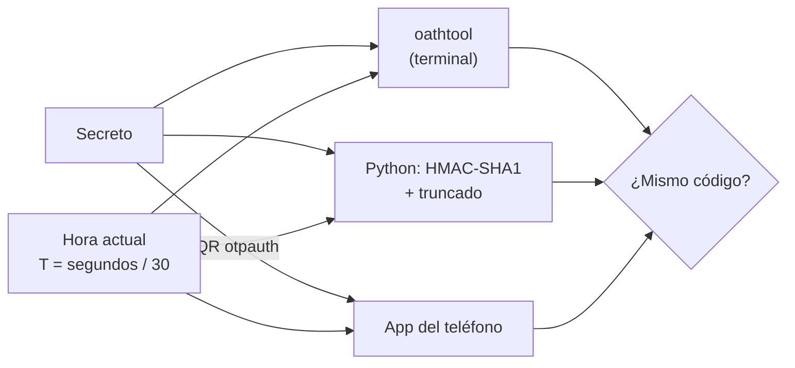
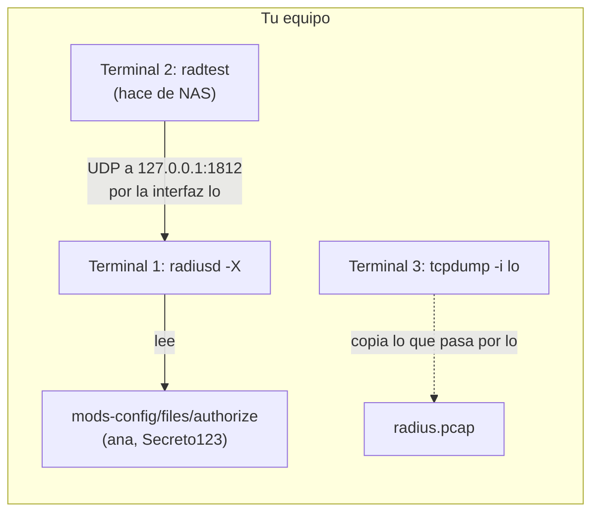
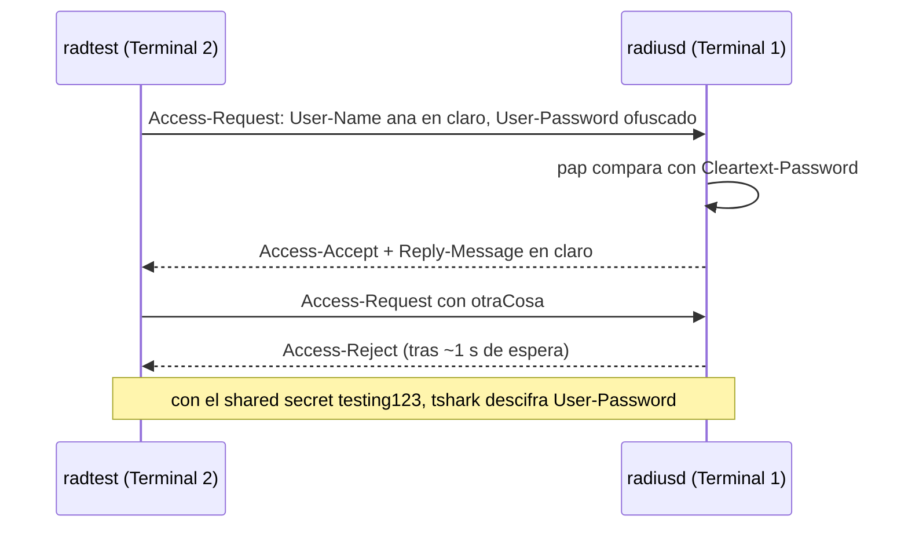
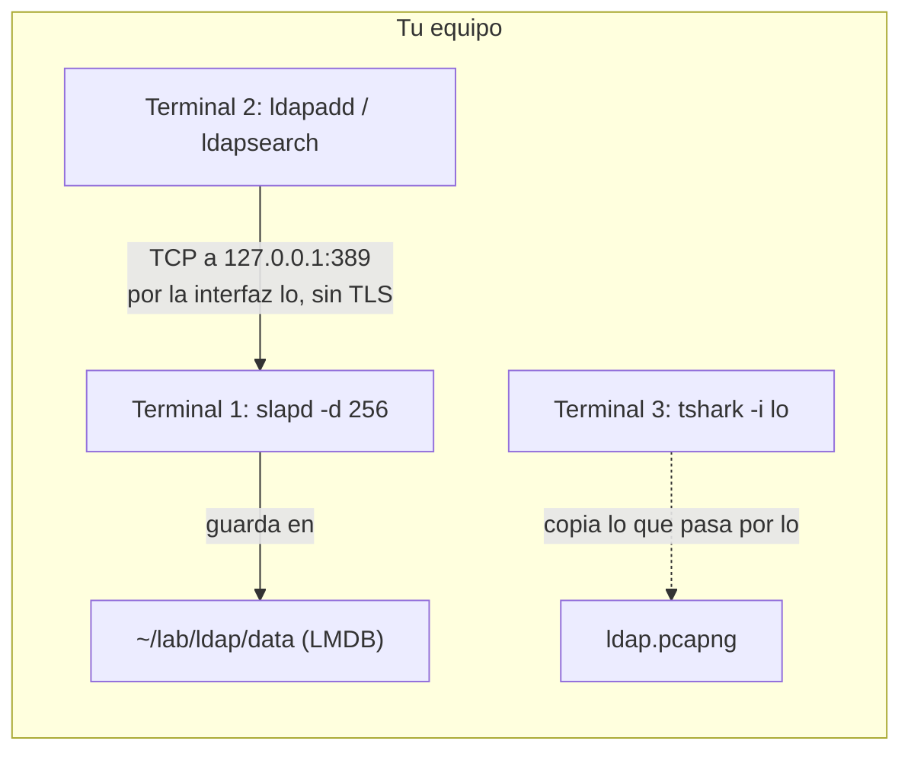
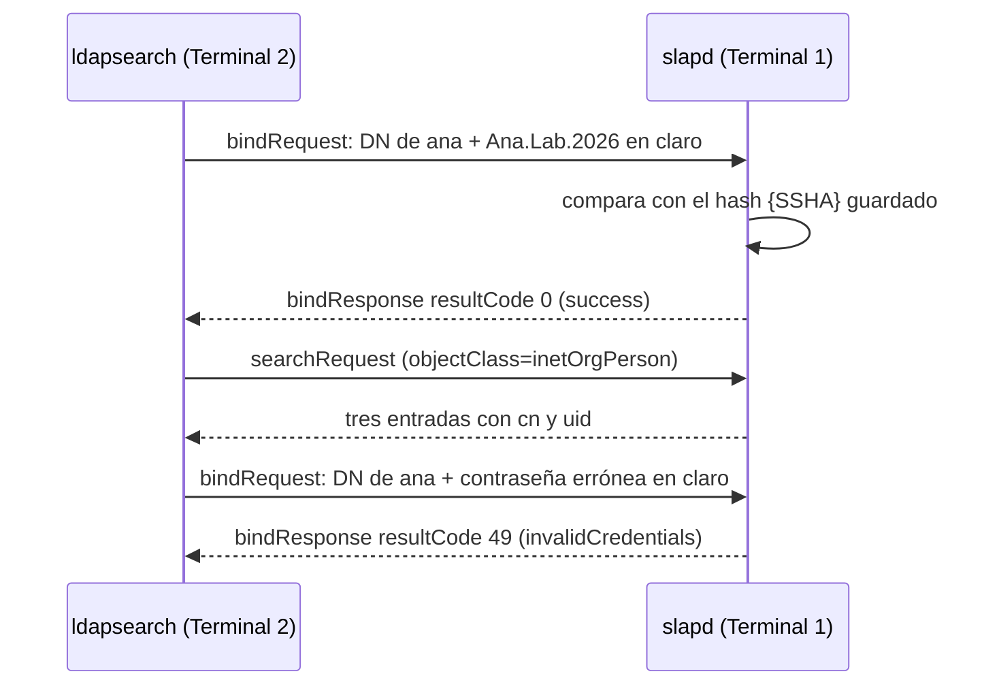
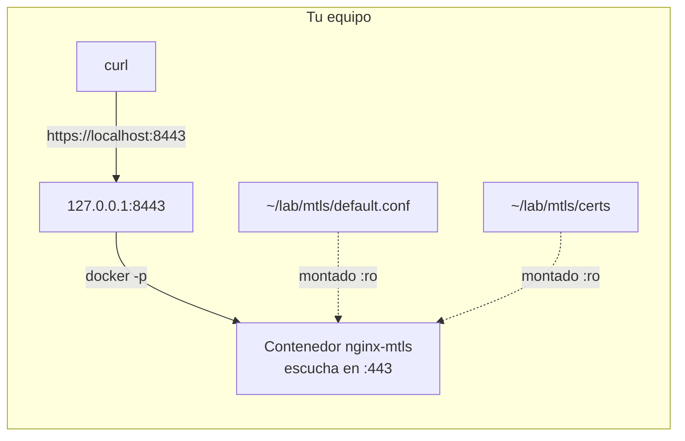
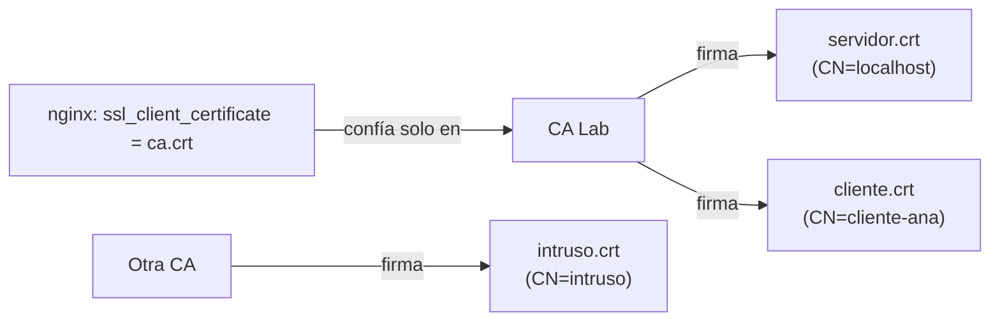
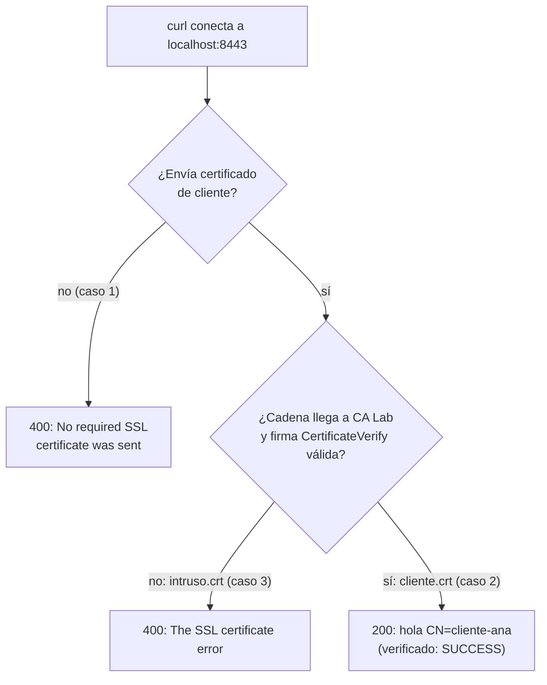

# Ejercicios: Autenticación

Ejercicios guiados para hacer en tu propio equipo o laboratorio. Cada uno dice qué vas
a lograr, qué necesitas, los pasos exactos y cómo comprobar que salió bien. La teoría
está en [README.md](README.md).

## Ejercicio 1: Reproduce y genera códigos TOTP

Nodo: MFA & 2FA, sección [TOTP](README.md#totp).

Objetivo: reproducir con `oathtool` el vector de prueba `94287082` de RFC 6238, comprobar que es solo un HMAC del reloj recalculándolo en Python, y después generar un secreto propio, cargarlo en una app autenticadora y verificar que la app y tu terminal dan el mismo código en cada ventana de 30 segundos.

Necesitas: un Linux con `oathtool` y `qrencode` (Debian/Ubuntu: `sudo apt install oathtool qrencode`; Arch: `sudo pacman -S oath-toolkit qrencode`), `python3`, y un teléfono con una app TOTP (Aegis, 2FAS, Google Authenticator o la de tu gestor de contraseñas). El reloj del equipo debe estar sincronizado (`timedatectl` debe decir `System clock synchronized: yes`). Tiempo: 20 minutos.

Qué vas a comprobar: el mismo secreto y la misma hora dan el mismo código por tres caminos, sin red de por medio.



### Pasos

1. Pasa el secreto del RFC a hexadecimal. El vector usa como secreto el texto ASCII `12345678901234567890`, y `oathtool` espera la clave en hex por defecto.
   ```bash
   printf 12345678901234567890 | od -An -tx1 | tr -d ' \n'; echo
   ```
   - `printf 12345678901234567890` → escribe el texto tal cual, sin salto de línea final (a diferencia de `echo`), para que no se cuele un `\n` en la clave.
   - `|` → pasa la salida de un comando como entrada del siguiente.
   - `od` → "octal dump": muestra bytes en distintos formatos.
   - `-An` → `-A` fija la base de la columna de direcciones; `n` (none) la quita, así solo salen los bytes.
   - `-tx1` → `-t` elige el formato de salida; `x1` es hexadecimal, un byte por grupo.
   - `tr -d ' \n'` → `tr` traduce o borra caracteres; `-d` borra todos los espacios y saltos de línea que pone `od`, dejando una sola cadena hex.
   - `;` → separa comandos: ejecuta el siguiente al terminar el anterior.
   - `echo` → sin argumentos imprime solo un salto de línea, para que el prompt no quede pegado a la salida.

   Salida: `3132333435363738393031323334353637383930` (cada `3x` es un dígito ASCII).
2. Reproduce el vector: TOTP con 8 dígitos en el segundo 59 de la época Unix.
   ```bash
   oathtool --totp -d 8 --now "1970-01-01 00:00:59 UTC" 3132333435363738393031323334353637383930
   ```
   - `oathtool` → genera y valida contraseñas de un solo uso OATH (HOTP y TOTP).
   - `--totp` → usa el modo TOTP, basado en la hora; sin valor usa HMAC-SHA1 (admite `--totp=SHA256` o `SHA512`). Sin esta opción, `oathtool` calcula HOTP por contador.
   - `-d 8` → (`--digits`) número de dígitos del código; los vectores del RFC usan 8, las apps suelen usar 6.
   - `--now "1970-01-01 00:00:59 UTC"` → (`-N`) usa esa fecha como hora actual en lugar del reloj del sistema; aquí, 59 segundos después de la época Unix.
   - `3132...3930` → la clave secreta (KEY), en hexadecimal, que es el formato por defecto.

   Salida esperada: `94287082`.
3. Reproduce otros dos vectores de la misma tabla del RFC para confirmar que no es casualidad.
   ```bash
   oathtool --totp -d 8 --now "2005-03-18 01:58:29 UTC" 3132333435363738393031323334353637383930
   oathtool --totp -d 8 --now "2009-02-13 23:31:30 UTC" 3132333435363738393031323334353637383930
   ```
   - `--totp`, `-d 8`, `--now` y la clave hex → (ver paso 2); solo cambia la fecha pasada a `--now`, que da otro contador `T`.

   Salidas esperadas: `07081804` y `89005924`.
4. Pide a `oathtool` que explique el cálculo del primer vector.
   ```bash
   oathtool --totp -v -d 8 --now "1970-01-01 00:00:59 UTC" 3132333435363738393031323334353637383930
   ```
   - `-v` → (`--verbose`) explica lo que hace: imprime los datos intermedios del cálculo además del código.
   - `--totp`, `-d 8`, `--now` y la clave hex → (ver paso 2).

   Verás el secreto, el tamaño de ventana (`Step size (seconds): 30`), la hora usada y `Counter: 0x1 (1)`: 59 / 30 = 1, redondeado hacia abajo, es la `T` de la fórmula del README.
5. Recalcula el mismo código a mano con Python, siguiendo la fórmula `T`, HMAC-SHA1 y truncado.
   ```bash
   python3 - <<'PY'
   import hmac, hashlib, struct
   secreto = b"12345678901234567890"
   t = 59 // 30
   h = hmac.new(secreto, struct.pack(">Q", t), hashlib.sha1).digest()
   o = h[-1] & 0x0F
   codigo = (struct.unpack(">I", h[o:o + 4])[0] & 0x7FFFFFFF) % 10**8
   print(f"{codigo:08d}")
   PY
   ```
   - `python3 -` → ejecuta Python leyendo el programa desde la entrada estándar (`-`) en vez de un archivo.
   - `<<'PY' ... PY` → heredoc: pasa como entrada todas las líneas hasta la línea `PY`; las comillas en `'PY'` impiden que la shell expanda `$` o comillas dentro del código.
   - `import hmac, hashlib, struct` → módulos para HMAC, funciones hash y empaquetado de enteros en bytes.
   - `secreto = b"12345678901234567890"` → la clave del RFC como bytes.
   - `t = 59 // 30` → contador de ventana: segundos desde la época divididos entre el periodo de 30 s, con división entera (vale 1).
   - `struct.pack(">Q", t)` → convierte `t` en 8 bytes: `>` big-endian (orden de red), `Q` entero sin signo de 64 bits, como pide el RFC.
   - `hmac.new(secreto, ..., hashlib.sha1).digest()` → calcula HMAC-SHA1 del contador con la clave y devuelve los 20 bytes del resultado.
   - `o = h[-1] & 0x0F` → truncado dinámico: los 4 bits bajos del último byte dan el desplazamiento (0 a 15).
   - `struct.unpack(">I", h[o:o + 4])[0]` → lee 4 bytes desde ese desplazamiento como entero sin signo de 32 bits big-endian (`I`).
   - `& 0x7FFFFFFF` → borra el bit más alto para que el número sea positivo.
   - `% 10**8` → se queda con los últimos 8 dígitos decimales.
   - `print(f"{codigo:08d}")` → imprime el código con 8 cifras, rellenando con ceros a la izquierda.

   Salida: `94287082`. No hay red ni servidor de por medio: solo el secreto y la hora.
6. Genera tu propio secreto de 160 bits en base32 (el formato que usan las apps) y guárdalo en una variable, sin que pase por el historial de la shell.
   ```bash
   SECRETO=$(head -c 20 /dev/urandom | base32)
   echo "$SECRETO"
   ```
   - `SECRETO=$(...)` → guarda en la variable `SECRETO` la salida del comando entre `$(` y `)` (sustitución de comandos).
   - `head -c 20` → lee solo los primeros 20 bytes (`-c` cuenta bytes, no líneas): 20 bytes son 160 bits.
   - `/dev/urandom` → fuente de bytes aleatorios del kernel, apta para claves.
   - `base32` → codifica esos bytes en base32 (alfabeto `A-Z` y `2-7`), el formato que esperan las apps TOTP.
   - `echo "$SECRETO"` → imprime el valor; las comillas evitan que la shell lo parta o interprete.

   Saldrán 32 caracteres de `A-Z` y `2-7`, por ejemplo `QC3Y2BARCFMGMAAJKSORTEPRSFF2OGQ7`.
7. Muestra el secreto como código QR en la terminal con una URI `otpauth`, el formato estándar que leen las apps.
   ```bash
   qrencode -t ansiutf8 "otpauth://totp/Lab:jony?secret=$SECRETO&issuer=Lab&algorithm=SHA1&digits=6&period=30"
   ```
   - `qrencode` → genera un código QR con el texto que recibe como argumento.
   - `-t ansiutf8` → (`--type`) tipo de salida: dibuja el QR en la terminal con caracteres UTF-8 y colores ANSI, en lugar del PNG por defecto.
   - `"otpauth://..."` → el texto a codificar, entre comillas para que la shell no interprete los `&`:
   - `otpauth://totp/` → esquema de URI para cuentas OTP, en modo TOTP.
   - `Lab:jony` → etiqueta de la cuenta: emisor y nombre de usuario que mostrará la app.
   - `secret=$SECRETO` → el secreto compartido en base32.
   - `issuer=Lab` → nombre del servicio emisor.
   - `algorithm=SHA1` → función hash del HMAC.
   - `digits=6` → longitud del código.
   - `period=30` → duración de cada ventana en segundos.

   Abre la app autenticadora del teléfono, elige añadir cuenta por QR y escanéalo. Aparecerá una entrada "Lab (jony)".
8. Genera el código actual y el de la siguiente ventana desde la terminal.
   ```bash
   oathtool --totp -b -w 1 "$SECRETO"
   ```
   - `--totp` → (ver paso 2).
   - `-b` → (`--base32`) indica que la clave está en base32 en vez de hexadecimal.
   - `-w 1` → (`--window`) genera 1 código adicional, el de la ventana siguiente.
   - `"$SECRETO"` → la clave, tomada de la variable del paso 6.

   La primera línea debe coincidir con la app; la segunda es el que mostrará la app cuando su contador de 30 s llegue a cero. Espera a ese cambio y compruébalo.
9. Simula un teléfono con el reloj 30 segundos adelantado: el código que calcula es el de la ventana siguiente, el que el servidor solo acepta si tolera una ventana de desfase.
   ```bash
   oathtool --totp -b --now "$(date -u -d '+30 sec' '+%F %T UTC')" "$SECRETO"
   ```
   - `--totp`, `--now` → (ver paso 2); `-b` → (ver paso 8).
   - `date` → muestra o calcula fechas.
   - `-u` → trabaja en UTC.
   - `-d '+30 sec'` → (`--date`) en vez de la hora actual, usa la hora actual más 30 segundos.
   - `'+%F %T UTC'` → formato de salida: `%F` es `AAAA-MM-DD`, `%T` es `HH:MM:SS`, y `UTC` se escribe literal para que `oathtool` sepa la zona.
   - `"$SECRETO"` → (ver paso 8).

   Debe coincidir con la segunda línea del paso 8.
10. Muestra el código y su cuenta atrás cada segundo, para compararlo un par de ciclos con la app. Sal con `Ctrl+C`.
    ```bash
    while true; do printf '\r%s  quedan %2ds ' "$(oathtool --totp -b "$SECRETO")" $((30 - $(date +%s) % 30)); sleep 1; done
    ```
    - `while true; do ...; done` → bucle infinito: repite el cuerpo hasta que lo cortes con `Ctrl+C`.
    - `printf '\r%s  quedan %2ds ' A B` → imprime con formato: `\r` vuelve al inicio de la línea para sobrescribirla, `%s` se sustituye por el código y `%2d` por los segundos, en un campo de 2 caracteres.
    - `"$(oathtool --totp -b "$SECRETO")"` → el código actual (opciones en pasos 2 y 8).
    - `$((...))` → expansión aritmética de la shell.
    - `date +%s` → segundos desde la época Unix.
    - `30 - ... % 30` → `%` es el resto de la división: segundos que faltan para que acabe la ventana de 30 s.
    - `sleep 1` → espera un segundo antes de la siguiente vuelta.

### Resultado esperado

Los tres vectores del RFC reproducidos con `oathtool` (y el primero también con Python), y una cuenta TOTP en tu teléfono cuyos códigos coinciden con los de la terminal en cada ventana de 30 segundos.

### Comprueba que lo lograste

- ¿Qué dos datos necesita la app para calcular el código? Respuesta: el secreto compartido y la hora actual; no necesita internet.
- ¿Por qué el contador del vector `94287082` vale 1? Respuesta: `floor(59 / 30) = 1`.
- Si alguien fotografía tu QR del paso 7, ¿qué obtiene? Respuesta: el secreto; podrá generar tus códigos para siempre. El QR es tan sensible como una contraseña.
- ¿Te protege TOTP de una página de phishing que reenvía el código al sitio real? Respuesta: no; el código vale unos 30 segundos y el proxy lo usa en ese tiempo. Solo FIDO2/passkeys corta ese ataque.

### Limpieza

Borra la entrada "Lab" de la app autenticadora y la variable de la shell: `unset SECRETO`.

## Ejercicio 2: Autentica contra FreeRADIUS y captura el tráfico

Nodo: [RADIUS](README.md#radius).

Objetivo: levantar FreeRADIUS en tu propio equipo con un usuario propio, obtener un `Access-Accept` y un `Access-Reject` con `radtest` desde otra terminal contra `127.0.0.1`, capturar los paquetes UDP 1812 en la interfaz de loopback y comprobar qué campos viajan en claro, cuál va ofuscado y que el shared secret basta para recuperar la contraseña.

Necesitas: un Linux con FreeRADIUS (incluye el servidor y el cliente `radtest`) y con `tcpdump` y `tshark`.

Instalación:
- Debian/Ubuntu: `sudo apt install freeradius freeradius-utils tcpdump tshark`
- Arch: `sudo pacman -S freeradius tcpdump wireshark-cli`

Todo ocurre dentro de tu equipo, en varias terminales: el servidor escucha en `127.0.0.1` y el cliente lo consulta desde otra terminal, siempre contra `127.0.0.1`. No apuntes `radtest` ni la captura contra ninguna máquina que no sea la tuya ni contra servicios que no hayas levantado tú en este equipo. En este laboratorio el servidor se arranca en primer plano en modo depuración (no como servicio del sistema), así que no hace falta `systemctl`; si ya tienes el servicio corriendo te robaría el puerto, páralo antes con `sudo systemctl stop freeradius`. Para capturar con `tshark` sin ser root, tu usuario debe estar en el grupo `wireshark`: `sudo usermod -aG wireshark $USER` y vuelve a iniciar sesión; en Debian/Ubuntu, además, `sudo dpkg-reconfigure wireshark-common` y responde "Sí" para permitir la captura sin root. Tiempo: 30 minutos.

Nota de rutas y nombres (cambian entre distros): el directorio de configuración es `/etc/raddb` en Arch y `/etc/freeradius/3.0` en Debian/Ubuntu; el binario del servidor es `radiusd` en Arch y `freeradius` en Debian/Ubuntu. Los pasos usan los nombres de Arch; sustitúyelos si vas por Debian.

Montaje del laboratorio, todo en tu equipo:



### Pasos

1. **Terminal 1 (servidor).** Añade una usuaria `ana` al archivo de usuarios de FreeRADIUS. La instalación ya trae un cliente `localhost` con el shared secret `testing123`, así que no hace falta tocar `clients.conf`. La segunda línea, indentada con espacios, es un atributo que el servidor devolverá en el Accept.
   ```bash
   sudo tee -a /etc/raddb/mods-config/files/authorize >/dev/null <<'EOF'

   ana     Cleartext-Password := "Secreto123"
           Reply-Message := "Bienvenida, ana"
   EOF
   ```
   - `sudo tee -a archivo >/dev/null` → `tee` escribe en el archivo lo que recibe por la entrada; `-a` (append) lo añade al final en vez de sobrescribir, y `>/dev/null` descarta la copia que `tee` haría por pantalla. Hace falta `sudo` porque el archivo es del sistema.
   - `<<'EOF' ... EOF` → heredoc: la entrada de `tee` son las líneas hasta `EOF`; con comillas, la shell no expande nada dentro.
   - `ana     Cleartext-Password := "Secreto123"` → entrada de usuario: `ana`, al inicio de línea, es el nombre; `Cleartext-Password := "Secreto123"` es el atributo de control con la contraseña contra la que compara el servidor (`:=` asigna reemplazando cualquier valor previo).
   - `        Reply-Message := "Bienvenida, ana"` → línea de continuación (empieza con espacios): atributo de respuesta que se añade al Access-Accept.

   Vale ponerla al principio o al final del archivo mientras no haya antes una entrada `DEFAULT` activa que la tape; en la configuración de serie esas entradas están comentadas, así que añadirla al final basta.

2. **Terminal 1 (servidor).** Arranca FreeRADIUS en primer plano, en modo depuración.
   ```bash
   sudo radiusd -X
   ```
   - `sudo` → el servidor necesita privilegios para abrir el puerto UDP 1812.
   - `radiusd` → el demonio de FreeRADIUS (en Debian/Ubuntu el binario se llama `freeradius`).
   - `-X` → modo depuración: se queda en primer plano y escribe el detalle de cada petición. Déjalo corriendo en esta terminal.

   La última línea debe ser `Ready to process requests`. Si sale un error de sintaxis, revisa la indentación de la entrada de `ana`.

3. **Terminal 3 (captura).** Antes de lanzar las peticiones, deja una captura del puerto de autenticación en la interfaz de loopback (cliente y servidor están los dos en `127.0.0.1`, así que el tráfico pasa por `lo`).
   ```bash
   sudo tcpdump -i lo -nn -w ~/radius.pcap 'udp port 1812'
   ```
   - `sudo` → capturar paquetes exige privilegios.
   - `tcpdump` → captura tráfico de red.
   - `-i lo` → captura en la interfaz de loopback, por donde viaja todo lo que va a `127.0.0.1`.
   - `-nn` → no traduce IPs a nombres ni puertos a nombres de servicio.
   - `-w ~/radius.pcap` → guarda los paquetes en ese archivo en lugar de imprimirlos.
   - `'udp port 1812'` → filtro de captura: solo UDP con origen o destino en el puerto 1812.

4. **Terminal 2 (cliente).** Prueba con la contraseña correcta.
   ```bash
   radtest ana Secreto123 127.0.0.1 0 testing123
   ```
   - `radtest` → cliente de pruebas que arma un Access-Request y lo envía con `radclient`; por defecto autentica con PAP.
   - `ana` → nombre de usuario (User-Name).
   - `Secreto123` → contraseña del usuario (User-Password).
   - `127.0.0.1` → servidor RADIUS; sin `:puerto` usa el 1812.
   - `0` → valor del atributo NAS-Port (puerto físico del NAS); en una prueba da igual.
   - `testing123` → shared secret del cliente, el que trae por defecto `clients.conf`.
   Salida esperada (resumida):
   ```
   Sent Access-Request Id 120 from 0.0.0.0:41234 to 127.0.0.1:1812 length 73
       User-Name = "ana"
       User-Password = "Secreto123"
   ...
   Received Access-Accept Id 120 from 127.0.0.1:1812 to 127.0.0.1:41234 length 38
       Reply-Message = "Bienvenida, ana"
   ```

5. **Terminal 2 (cliente).** Prueba con una contraseña incorrecta.
   ```bash
   radtest ana otraCosa 127.0.0.1 0 testing123
   ```
   - Mismos argumentos que en el paso 4, con `otraCosa` como contraseña.
   Llega `Received Access-Reject` (tras una espera de alrededor de un segundo que el servidor añade a propósito para frenar ataques de fuerza bruta).

6. **Terminal 1 (servidor).** Mira en la salida de depuración qué decidió el servidor y por qué. Para la primera petición verás `pap: User authenticated successfully` seguido de `Sent Access-Accept`; para la segunda, un `pap: ERROR: ... password does not match "known good" password` seguido de `Sent Access-Reject`. El módulo `pap` es el que comparó la contraseña recibida con la del archivo de usuarios.

7. **Terminal 3 (captura).** Detén tcpdump con `Ctrl+C` y mira el contenido en hexadecimal y ASCII.
   ```bash
   sudo chown "$USER" ~/radius.pcap
   tcpdump -nn -X -r ~/radius.pcap | head -40
   ```
   - `sudo chown "$USER" ~/radius.pcap` → cambia el dueño del archivo (creado por root) a tu usuario; `$USER` contiene tu nombre de usuario.
   - `-nn` → (ver paso 3).
   - `-X` → imprime el contenido de cada paquete en hexadecimal y en ASCII.
   - `-r ~/radius.pcap` → lee los paquetes del archivo en lugar de capturar.
   - `head -40` → muestra solo las 40 primeras líneas.
   En la columna ASCII de la derecha se lee `ana` (el User-Name) y, en la respuesta, `Bienvenida, ana`; `Secreto123` no aparece.

8. **Terminal 2 o 3.** Decodifica los campos con tshark, sin el secreto.
   ```bash
   tshark -r ~/radius.pcap -Y radius -T fields -e radius.code -e radius.User_Name -e radius.User_Password
   ```
   - `tshark` → versión de terminal de Wireshark.
   - `-r ~/radius.pcap` → lee el archivo de captura.
   - `-Y radius` → filtro de visualización: solo paquetes que Wireshark decodifica como RADIUS.
   - `-T fields` → formato de salida: solo los campos que pidas con `-e`, separados por tabuladores.
   - `-e radius.code` → campo con el tipo de paquete RADIUS.
   - `-e radius.User_Name` → campo con el nombre de usuario.
   - `-e radius.User_Password` → campo con la contraseña tal como viaja.
   Código 1 es Access-Request, 2 Access-Accept, 3 Access-Reject. `User_Name` sale como `ana`; `User_Password` sale como bytes ilegibles (16 bytes en hex): está ofuscado con MD5 y el shared secret.

9. **Terminal 2 o 3.** Ahora dale a tshark el shared secret y mira el campo de contraseña de los Access-Request.
   ```bash
   tshark -r ~/radius.pcap -o radius.shared_secret:testing123 -Y 'radius.code == 1' -V | grep -i -A1 'User-Password'
   ```
   - `-r ~/radius.pcap` → (ver paso 8).
   - `-o radius.shared_secret:testing123` → cambia una preferencia de Wireshark (`nombre:valor`): aquí el shared secret que usa el disector RADIUS para descifrar User-Password.
   - `-Y 'radius.code == 1'` → solo los paquetes con código 1 (Access-Request).
   - `-V` → imprime el árbol de detalle completo de cada paquete.
   - `grep -i` → busca sin distinguir mayúsculas y minúsculas.
   - `-A1` → muestra además 1 línea después de cada coincidencia.
   - `'User-Password'` → texto a buscar.
   Junto al valor cifrado aparece la contraseña descifrada: `Secreto123` en el primer intento y `otraCosa` en el segundo. Quien conozca el secreto y capture el tráfico obtiene las contraseñas.

Lo que viaja en cada intento y qué se lee en la captura:



### Resultado esperado

Un `Access-Accept` con su `Reply-Message` y un `Access-Reject`, la salida de depuración del servidor explicando cada decisión, y una captura `radius.pcap` en la que has comprobado tres cosas: el usuario y los atributos viajan en claro, la contraseña va ofuscada, y con el shared secret se descifra.

### Comprueba que lo lograste

- ¿Qué campo de un Access-Request protege el shared secret? Respuesta: solo User-Password; el resto del paquete va en claro.
- ¿Por qué un shared secret como `testing123` es un problema aunque la red sea interna? Respuesta: quien lo adivine o lo lea de un NAS y capture tráfico descifra todas las contraseñas.
- ¿Qué devuelve el servidor además de "sí" en el Access-Accept, y qué A de AAA es eso? Respuesta: atributos (aquí Reply-Message; en producción VLAN o tiempo de sesión); es autorización.
- ¿Qué dos mitigaciones da el README frente a ataques como Blast-RADIUS? Respuesta: exigir Message-Authenticator en todos los paquetes, o llevar RADIUS dentro de TLS (RadSec, TCP 2083).

### Limpieza

1. En la Terminal 1, para el servidor con `Ctrl+C`.
2. Quita la entrada de prueba: edita `/etc/raddb/mods-config/files/authorize` (con `sudo`) y borra las dos líneas de `ana` que añadiste en el paso 1.
3. Borra la captura:
   ```bash
   rm -f ~/radius.pcap
   ```
   - `rm -f ~/radius.pcap` → borra el archivo de captura; `-f` no pregunta ni da error si no existe.

## Ejercicio 3: Monta OpenLDAP y observa un bind simple en claro

Nodo: [LDAP](README.md#ldap).

Objetivo: levantar un directorio OpenLDAP propio con dos OUs y tres usuarios en tu equipo, autenticarte con un bind simple sin TLS desde otra terminal contra `127.0.0.1` mientras capturas en loopback, y localizar en la captura el DN y la contraseña en texto claro; además, distinguir un bind correcto de uno fallido.

Necesitas: un Linux con OpenLDAP (el servidor `slapd` y los clientes `ldapsearch`/`ldapadd`/`slappasswd`) y con `tcpdump` y `tshark`.

Instalación:
- Debian/Ubuntu: `sudo apt install slapd ldap-utils tcpdump tshark`
- Arch: `sudo pacman -S openldap tcpdump wireshark-cli`

En Arch el paquete `openldap` trae tanto el servidor `slapd` como los clientes y `slappasswd`; en Debian/Ubuntu el servidor es `slapd` y los clientes van en `ldap-utils`. Todo ocurre en tu equipo, en varias terminales: el servidor escucha en `127.0.0.1` y el cliente lo consulta desde otra terminal. En un entorno real el servidor y el cliente estarían en máquinas distintas; aquí comparten la interfaz de loopback, pero el paquete del bind y la contraseña en claro que vas a observar son idénticos. Trabaja solo contra este servidor que tú mismo levantas en `127.0.0.1`. Para capturar con `tshark` sin ser root, añade tu usuario al grupo `wireshark` (`sudo usermod -aG wireshark $USER`, luego reinicia sesión; en Debian/Ubuntu además `sudo dpkg-reconfigure wireshark-common`). En este laboratorio `slapd` se arranca en primer plano desde una configuración propia, así que no toca el servicio del sistema ni necesita `systemctl`. Referencia: [OpenLDAP Administrator's Guide](https://www.openldap.org/doc/admin26/). Tiempo: 45 minutos.

Montaje del laboratorio, todo en tu equipo:



### Pasos

1. **Terminal 1 (servidor).** Crea la carpeta de trabajo y una configuración mínima de `slapd` en formato clásico `slapd.conf` (el más simple para un laboratorio; `slapd` lo convierte solo al arrancar).
   ```bash
   mkdir -p ~/lab/ldap/data && cd ~/lab/ldap
   cat > slapd.conf <<EOF
   include /etc/openldap/schema/core.schema
   include /etc/openldap/schema/cosine.schema
   include /etc/openldap/schema/inetorgperson.schema

   database  mdb
   maxsize   1073741824
   suffix    "dc=lab,dc=local"
   rootdn    "cn=admin,dc=lab,dc=local"
   rootpw    Admin.Lab.2026
   directory $HOME/lab/ldap/data
   EOF
   ```
   - `mkdir -p ~/lab/ldap/data && cd ~/lab/ldap` → crea la carpeta de datos (y las intermedias) y entra en la de trabajo; `&&` encadena si la primera orden fue bien.
   - `cat > slapd.conf <<EOF ... EOF` → heredoc **sin** comillas en `EOF`, para que la shell expanda `$HOME` dentro; escribe el archivo de configuración.
   - `include /etc/openldap/schema/*.schema` → carga los esquemas (definiciones de clases y atributos); `inetorgperson` define la clase de las personas. En Debian/Ubuntu las rutas son `/etc/ldap/schema/...` (ajústalas) y, además, hay que cargar el backend como módulo: añade al principio `modulepath /usr/lib/ldap` y `moduleload back_mdb`. En Arch el backend `mdb` viene integrado y no hace falta.
   - `database mdb` → backend de almacenamiento LMDB, el recomendado.
   - `maxsize 1073741824` → tamaño máximo del mapa de memoria de LMDB (1 GiB, de sobra para el laboratorio).
   - `suffix "dc=lab,dc=local"` → raíz del árbol que sirve este directorio.
   - `rootdn "cn=admin,dc=lab,dc=local"` → DN del administrador del directorio.
   - `rootpw Admin.Lab.2026` → su contraseña (en claro vale para un laboratorio; en producción un hash de `slappasswd`).
   - `directory $HOME/lab/ldap/data` → carpeta donde LMDB guarda la base de datos; debe existir y ser una ruta absoluta (por eso se expande `$HOME`).

2. **Terminal 1 (servidor).** Arranca slapd en primer plano, escuchando solo en loopback.
   ```bash
   sudo slapd -f slapd.conf -h "ldap://127.0.0.1:389" -d 256
   ```
   - `sudo` → el puerto 389 es privilegiado, hace falta root para abrirlo.
   - `slapd` → el servidor OpenLDAP (en Arch está en el PATH; en Debian/Ubuntu es `/usr/sbin/slapd`).
   - `-f slapd.conf` → usa este archivo de configuración clásico.
   - `-h "ldap://127.0.0.1:389"` → URL donde escuchar: protocolo `ldap` (sin cifrar) en loopback, puerto 389. Al atarlo a `127.0.0.1` el directorio no queda expuesto a la red.
   - `-d 256` → nivel de depuración 256 (estadísticas de conexión); además mantiene slapd en primer plano. Déjalo corriendo en esta terminal.

   Verás las líneas de arranque y `slapd starting`. Si falla por los esquemas, ajusta las rutas `include` a las de tu distro.

3. **Terminal 2 (cliente).** Crea el archivo con la raíz del árbol y las dos OUs.
   ```bash
   cd ~/lab/ldap
   cat > base.ldif <<'EOF'
   dn: dc=lab,dc=local
   objectClass: dcObject
   objectClass: organization
   o: Lab
   dc: lab

   dn: ou=Contabilidad,dc=lab,dc=local
   objectClass: organizationalUnit
   ou: Contabilidad

   dn: ou=TI,dc=lab,dc=local
   objectClass: organizationalUnit
   ou: TI
   EOF
   ```
   - `cat > base.ldif <<'EOF' ... EOF` → escribe las líneas del heredoc en `base.ldif` sin expandir nada (comillas en `'EOF'`).
   - `dn: dc=lab,dc=local` → la entrada raíz del árbol; su DN coincide con el `suffix` del servidor.
   - `objectClass: dcObject` / `objectClass: organization` → clases de la raíz: componente de dominio y organización.
   - `o: Lab` / `dc: lab` → atributos obligatorios de esas clases (nombre de la organización y componente de dominio).
   - Línea en blanco → separa una entrada de la siguiente en LDIF.
   - `dn: ou=Contabilidad,dc=lab,dc=local` → la OU `Contabilidad` colgando de la raíz; `objectClass: organizationalUnit` la define como unidad organizativa y `ou: Contabilidad` es su nombre.
   - `dn: ou=TI,...` → la segunda OU, con las mismas directivas.

4. **Terminal 2 (cliente).** Crea el archivo de los tres usuarios. El heredoc sin comillas ejecuta `slappasswd`, que convierte cada contraseña en un hash `{SSHA}` antes de escribirla.
   ```bash
   cat > usuarios.ldif <<EOF
   dn: uid=ana,ou=Contabilidad,dc=lab,dc=local
   objectClass: inetOrgPerson
   uid: ana
   cn: Ana Rojas
   sn: Rojas
   userPassword: $(slappasswd -s 'Ana.Lab.2026')

   dn: uid=luis,ou=Contabilidad,dc=lab,dc=local
   objectClass: inetOrgPerson
   uid: luis
   cn: Luis Mora
   sn: Mora
   userPassword: $(slappasswd -s 'Luis.Lab.2026')

   dn: uid=marta,ou=TI,dc=lab,dc=local
   objectClass: inetOrgPerson
   uid: marta
   cn: Marta Solis
   sn: Solis
   userPassword: $(slappasswd -s 'Marta.Lab.2026')
   EOF
   grep userPassword usuarios.ldif
   ```
   - `cat > usuarios.ldif <<EOF` → heredoc **sin** comillas: la shell sí expande `$(...)`, por eso se ejecuta `slappasswd`.
   - `dn: uid=ana,ou=Contabilidad,dc=lab,dc=local` → DN del usuario: `uid=ana` dentro de la OU Contabilidad.
   - `objectClass: inetOrgPerson` → clase estándar para personas de una organización; exige `cn` y `sn`.
   - `uid: ana` → identificador de inicio de sesión.
   - `cn: Ana Rojas` → nombre común (completo).
   - `sn: Rojas` → apellido (surname).
   - `userPassword: $(slappasswd -s 'Ana.Lab.2026')` → contraseña de la entrada, rellenada con la salida de `slappasswd`.
   - `slappasswd` → genera el hash de una contraseña en el formato que guarda OpenLDAP; por defecto el esquema `{SSHA}` (SHA-1 con sal). En Debian/Ubuntu está en `/usr/sbin/slappasswd`.
   - `-s 'Ana.Lab.2026'` → la contraseña a convertir en hash, en lugar de pedirla por teclado.
   - Las entradas de `luis` y `marta` → mismas directivas con otros valores.
   - `grep userPassword usuarios.ldif` → muestra solo las líneas con `userPassword`; cada una debe empezar por `{SSHA}`.

5. **Terminal 2 (cliente).** Carga los dos archivos como administrador. Primero la raíz y las OUs, porque los usuarios cuelgan de ellas.
   ```bash
   ldapadd -x -H ldap://127.0.0.1 -D cn=admin,dc=lab,dc=local -W -f base.ldif
   ldapadd -x -H ldap://127.0.0.1 -D cn=admin,dc=lab,dc=local -W -f usuarios.ldif
   ```
   - `ldapadd` → añade entradas nuevas a un directorio.
   - `-x` → usa autenticación simple en vez de SASL.
   - `-H ldap://127.0.0.1` → URI del servidor: LDAP sin cifrar (puerto 389) en loopback.
   - `-D cn=admin,dc=lab,dc=local` → DN con el que se hace el bind: el administrador (el `rootdn` del paso 1).
   - `-W` → pide la contraseña del bind por teclado (`Admin.Lab.2026`), en vez de escribirla en la línea de comandos.
   - `-f base.ldif` → lee las entradas de ese archivo.
   Cada entrada imprime `adding new entry "..."`. Si sale `Invalid credentials (49)`, la contraseña no es la del `rootpw`.

6. **Terminal 2 (cliente).** Comprueba el árbol con un bind anónimo.
   ```bash
   ldapsearch -x -H ldap://127.0.0.1 -b dc=lab,dc=local -LLL dn
   ```
   - `ldapsearch` → cliente que hace búsquedas en un directorio LDAP.
   - `-x` → autenticación simple; sin `-D` el bind es anónimo.
   - `-H ldap://127.0.0.1` → (ver paso 5).
   - `-b dc=lab,dc=local` → base de la búsqueda: el punto del árbol desde el que se busca.
   - `-LLL` → salida en formato LDIF, sin comentarios ni línea de versión.
   - `dn` → atributo que se pide; como el DN siempre se imprime, sirve para listar solo los nombres. Sin filtro se usa `(objectClass=*)`, que coincide con todas.

   Salen seis DN: la raíz, las dos OUs y los tres usuarios. Esa consulta fue **anónima** y devolvió datos: anótalo, con esta configuración mínima el directorio deja leer el árbol sin autenticación; en un directorio real eso debe limitarse.

7. **Terminal 3 (captura).** Date permisos de captura (ver "Necesitas") y deja corriendo una captura del puerto LDAP en loopback.
   ```bash
   sudo tshark -i lo -f "tcp port 389" -w ~/lab/ldap/ldap.pcapng
   ```
   - `sudo` → capturar en una interfaz requiere privilegios (o estar en el grupo `wireshark`).
   - `tshark` → versión de terminal de Wireshark.
   - `-i lo` → captura en loopback, por donde habla el cliente con el servidor en `127.0.0.1`.
   - `-f "tcp port 389"` → filtro de captura (sintaxis BPF): solo TCP con origen o destino en el 389 (LDAP sin cifrar).
   - `-w ~/lab/ldap/ldap.pcapng` → escribe los paquetes en ese archivo en formato pcapng.

8. **Terminal 2 (cliente).** Autentícate como `ana` con bind simple y busca a las personas. Cuando pida la contraseña, escribe `Ana.Lab.2026`.
   ```bash
   ldapsearch -x -H ldap://127.0.0.1 -D uid=ana,ou=Contabilidad,dc=lab,dc=local -W \
     -b dc=lab,dc=local -LLL '(objectClass=inetOrgPerson)' cn uid
   ```
   - `-x` → bind simple: la contraseña viaja tal cual dentro del mensaje.
   - `-H ldap://127.0.0.1` → el servidor, sin cifrar.
   - `-D uid=ana,ou=Contabilidad,dc=lab,dc=local` → DN con el que te autenticas: la usuaria `ana`.
   - `-W` → pide la contraseña por teclado.
   - `\` → continúa el comando en la línea siguiente.
   - `-b dc=lab,dc=local`, `-LLL` → (ver paso 6).
   - `'(objectClass=inetOrgPerson)'` → filtro de búsqueda: solo las personas.
   - `cn uid` → atributos que se devuelven de cada entrada.
   Devuelve las tres personas con su `cn` y `uid`.

9. **Terminal 2 (cliente).** Repite con una contraseña equivocada (escribe cualquier otra cosa cuando la pida).
   ```bash
   ldapsearch -x -H ldap://127.0.0.1 -D uid=ana,ou=Contabilidad,dc=lab,dc=local -W -b dc=lab,dc=local -LLL dn
   ```
   - `-x`, `-H`, `-D`, `-W` → (ver paso 8); `-b`, `-LLL`, `dn` → (ver paso 6).

   Responde `ldap_bind: Invalid credentials (49)`.

10. **Terminal 3 (captura).** Detén la captura con `Ctrl+C` y extrae las peticiones de bind con su contraseña en claro.
    ```bash
    tshark -r ~/lab/ldap/ldap.pcapng -Y 'ldap.protocolOp == 0' -T fields -e ip.src -e ldap.name -e ldap.simple
    ```
    - `tshark -r ~/lab/ldap/ldap.pcapng` → lee la captura guardada.
    - `-Y 'ldap.protocolOp == 0'` → filtro de visualización: el valor 0 es `bindRequest`, la petición de autenticación.
    - `-T fields` → imprime solo los campos pedidos con `-e`.
    - `-e ip.src` → IP de origen del paquete.
    - `-e ldap.name` → el DN con el que se hace el bind.
    - `-e ldap.simple` → la contraseña del bind simple.
    Dos líneas, ambas desde `127.0.0.1`, con el DN de `ana` y cada contraseña tal como se tecleó (`Ana.Lab.2026` y la errónea): la contraseña viaja en texto claro.

11. **Terminal 3 (captura).** Mira las respuestas del servidor.
    ```bash
    tshark -r ~/lab/ldap/ldap.pcapng -Y 'ldap.protocolOp == 1' -T fields -e ldap.resultCode
    ```
    - `-Y 'ldap.protocolOp == 1'` → el valor 1 es `bindResponse`, la respuesta del servidor al bind.
    - `-e ldap.resultCode` → código de resultado del bind.
    El primero sale `0` (success) y el segundo `49` (invalidCredentials). Un IDS o un SIEM que vea muchos 49 seguidos del mismo origen está viendo fuerza bruta.

Lo que muestran los pasos 8 a 11 en la captura:



### Resultado esperado

Un directorio `dc=lab,dc=local` con `ou=Contabilidad` (ana, luis) y `ou=TI` (marta), y una captura `ldap.pcapng` donde se leen el DN y la contraseña de dos binds simples, uno con `success (0)` y otro con `invalidCredentials (49)`.

### Comprueba que lo lograste

- ¿Qué operación LDAP es la autenticación y en qué paquete viaja la contraseña? Respuesta: el Bind; va en el campo `simple` del `bindRequest`.
- La contraseña está guardada como `{SSHA}` en el servidor. ¿Por qué igualmente se ve en claro en la red? Respuesta: el hash protege el almacenamiento, no el transporte; el bind simple manda la contraseña tal cual y el servidor la compara con el hash.
- ¿Qué tres opciones evitan que se vea? Respuesta: StartTLS en el 389 (`ldapsearch -ZZ`), LDAPS en el 636, o un bind SASL (por ejemplo Kerberos/GSSAPI) que no manda la contraseña.
- ¿Qué hallazgo de configuración apareció en el paso 6? Respuesta: el bind anónimo puede leer el árbol; en un directorio real debe desactivarse o limitarse.

### Limpieza

1. En la Terminal 1, para el servidor con `Ctrl+C`.
2. Borra la carpeta del laboratorio (incluye la base de datos y la captura):
   ```bash
   rm -rf ~/lab/ldap
   ```
   - `rm -rf ~/lab/ldap` → borra la carpeta de forma recursiva y sin preguntar.

## Ejercicio 4: Exige certificado de cliente en nginx con mTLS

Nodo: [Certificates](README.md#certificates) y [mTLS](README.md#mtls).

Objetivo: crear con `openssl` una CA propia, emitir con ella un certificado de servidor y uno de cliente, configurar nginx con `ssl_verify_client on` y demostrar con `curl` tres casos: sin certificado de cliente se rechaza, con el certificado de tu CA se acepta y nginx lee tu identidad, y con un certificado de otra CA se rechaza.

Necesitas: un Linux con `openssl` y `curl` (vienen en casi todas las distribuciones) y Docker para nginx (Debian/Ubuntu: `sudo apt install docker.io`; Arch: `sudo pacman -S docker`; después `sudo systemctl start docker`). Todo en tu equipo, en `localhost`. Tiempo: 30 minutos.

Montaje del laboratorio: nginx corre en un contenedor de tu propio equipo, publicado solo en `127.0.0.1`.



Quién firma qué y en qué confía nginx:



### Pasos

1. Crea la carpeta de trabajo.
   ```bash
   mkdir -p ~/lab/mtls/certs && cd ~/lab/mtls/certs
   ```
   - `mkdir -p` → crea el directorio y los padres que falten; `&&` encadena si la orden anterior fue bien; `cd` entra en la carpeta.
2. Crea la CA: una clave RSA 3072 y un certificado autofirmado de un año marcado como CA.
   ```bash
   openssl req -x509 -newkey rsa:3072 -sha256 -days 365 -nodes \
     -keyout ca.key -out ca.crt -subj "/CN=CA Lab" \
     -addext "basicConstraints=critical,CA:TRUE" \
     -addext "keyUsage=critical,keyCertSign,cRLSign"
   ```
   - `openssl req` → subcomando para crear peticiones de certificado (CSR) y, con `-x509`, certificados autofirmados.
   - `-x509` → genera directamente un certificado autofirmado en vez de una petición.
   - `-newkey rsa:3072` → crea una clave nueva RSA de 3072 bits.
   - `-sha256` → firma con el resumen SHA-256.
   - `-days 365` → validez del certificado en días.
   - `-nodes` → no cifra la clave privada con contraseña (en OpenSSL 3 su nombre nuevo es `-noenc`).
   - `\` → continúa el comando en la línea siguiente.
   - `-keyout ca.key` → archivo donde se guarda la clave privada.
   - `-out ca.crt` → archivo donde se guarda el certificado.
   - `-subj "/CN=CA Lab"` → sujeto del certificado sin preguntas interactivas; `CN` es el nombre común.
   - `-addext "basicConstraints=critical,CA:TRUE"` → añade la extensión que marca el certificado como CA; `critical` obliga a quien lo valide a entenderla.
   - `-addext "keyUsage=critical,keyCertSign,cRLSign"` → limita la clave a firmar certificados y listas de revocación (CRL).
3. Crea la clave y la petición (CSR) del servidor, y fírmala con la CA añadiendo el SAN `localhost` (los clientes solo miran el SAN) y el uso `serverAuth`.
   ```bash
   openssl req -newkey rsa:2048 -nodes -keyout servidor.key -out servidor.csr -subj "/CN=localhost"
   cat > servidor.ext <<'EOF'
   basicConstraints=CA:FALSE
   keyUsage=critical,digitalSignature,keyEncipherment
   extendedKeyUsage=serverAuth
   subjectAltName=DNS:localhost,IP:127.0.0.1
   EOF
   openssl x509 -req -in servidor.csr -CA ca.crt -CAkey ca.key -CAcreateserial \
     -days 30 -sha256 -extfile servidor.ext -out servidor.crt
   ```
   - `openssl req -newkey rsa:2048 -nodes -keyout servidor.key -subj "/CN=localhost"` → (ver paso 2); sin `-x509` genera una petición (CSR) con una clave RSA de 2048 bits.
   - `-out servidor.csr` → archivo donde se guarda la CSR.
   - `cat > servidor.ext <<'EOF' ... EOF` → `cat` vuelca en `servidor.ext` las líneas del heredoc; con comillas en `'EOF'` la shell no expande nada dentro.
   - `basicConstraints=CA:FALSE` → este certificado no puede firmar otros.
   - `keyUsage=critical,digitalSignature,keyEncipherment` → la clave sirve para firmar y para cifrar claves de sesión.
   - `extendedKeyUsage=serverAuth` → uso permitido: autenticar un servidor TLS.
   - `subjectAltName=DNS:localhost,IP:127.0.0.1` → nombres válidos del servidor (SAN): el nombre `localhost` y la IP `127.0.0.1`.
   - `openssl x509` → subcomando para mostrar, convertir y firmar certificados.
   - `-req` → la entrada es una CSR, no un certificado.
   - `-in servidor.csr` → archivo de entrada.
   - `-CA ca.crt` → certificado de la CA que firma.
   - `-CAkey ca.key` → clave privada de esa CA.
   - `-CAcreateserial` → crea el archivo de número de serie de la CA (`ca.srl`) si no existe.
   - `-days 30` → validez en días.
   - `-sha256` → firma con SHA-256.
   - `-extfile servidor.ext` → archivo con las extensiones X.509 que se añaden al certificado.
   - `-out servidor.crt` → certificado firmado resultante.
   Imprime `Certificate request self-signature ok` y `subject=CN=localhost`.
4. Lo mismo para el cliente, con el uso `clientAuth`. Su CN será la identidad que verá nginx.
   ```bash
   openssl req -newkey rsa:2048 -nodes -keyout cliente.key -out cliente.csr -subj "/CN=cliente-ana"
   cat > cliente.ext <<'EOF'
   basicConstraints=CA:FALSE
   keyUsage=critical,digitalSignature
   extendedKeyUsage=clientAuth
   EOF
   openssl x509 -req -in cliente.csr -CA ca.crt -CAkey ca.key -CAcreateserial \
     -days 30 -sha256 -extfile cliente.ext -out cliente.crt
   ```
   - `openssl req ...` y `openssl x509 ...` → mismas opciones que en el paso 3, con los archivos `cliente.*` y el sujeto `/CN=cliente-ana`.
   - `basicConstraints=CA:FALSE` → (ver paso 3).
   - `keyUsage=critical,digitalSignature` → la clave solo firma (el cliente firma el handshake).
   - `extendedKeyUsage=clientAuth` → uso permitido: autenticar a un cliente TLS.
5. Verifica la cadena y mira los campos del certificado de cliente.
   ```bash
   openssl verify -CAfile ca.crt servidor.crt cliente.crt
   openssl x509 -in cliente.crt -noout -subject -issuer -dates -ext extendedKeyUsage
   ```
   - `openssl verify` → comprueba la cadena de confianza de uno o más certificados.
   - `-CAfile ca.crt` → archivo con los certificados de confianza contra los que se valida.
   - `servidor.crt cliente.crt` → certificados a verificar.
   - `openssl x509 -in cliente.crt` → lee ese certificado.
   - `-noout` → no vuelve a imprimir el certificado codificado, solo lo que se pida.
   - `-subject` → imprime el DN del sujeto.
   - `-issuer` → imprime el DN del emisor.
   - `-dates` → imprime las fechas `notBefore` y `notAfter`.
   - `-ext extendedKeyUsage` → imprime solo esa extensión.
   Salida: `servidor.crt: OK`, `cliente.crt: OK`; `subject=CN=cliente-ana`, `issuer=CN=CA Lab`, las fechas de validez y `TLS Web Client Authentication`.
6. Crea un certificado de cliente de una CA ajena, para el caso negativo: una segunda CA y un cliente firmado por ella.
   ```bash
   openssl req -x509 -newkey rsa:2048 -sha256 -days 30 -nodes -keyout otra-ca.key -out otra-ca.crt \
     -subj "/CN=Otra CA" -addext "basicConstraints=critical,CA:TRUE" -addext "keyUsage=critical,keyCertSign"
   openssl req -newkey rsa:2048 -nodes -keyout intruso.key -out intruso.csr -subj "/CN=intruso"
   openssl x509 -req -in intruso.csr -CA otra-ca.crt -CAkey otra-ca.key -CAcreateserial \
     -days 30 -sha256 -extfile cliente.ext -out intruso.crt
   chmod 644 *.crt *.key
   ```
   - Primer `openssl req -x509 ...` → crea la segunda CA con las opciones del paso 2 (clave de 2048 bits, 30 días, `CN=Otra CA`, sin `cRLSign`).
   - Segundo `openssl req ...` → CSR del intruso (ver paso 3).
   - `openssl x509 -req ... -CA otra-ca.crt -CAkey otra-ca.key` → firma la CSR con la CA ajena (resto de opciones en el paso 3); reutiliza `cliente.ext`.
   - `chmod 644` → permisos de lectura y escritura para el dueño y solo lectura para grupo y otros; deja que el nginx del contenedor lea los archivos. En un servidor real las claves serían `600` y propiedad del usuario del servicio.
   - `*.crt *.key` → la shell expande los comodines a todos los certificados y claves de la carpeta.
7. Escribe la configuración completa de nginx. La respuesta devuelve el DN del cliente que nginx validó.
   ```bash
   cat > ~/lab/mtls/default.conf <<'EOF'
   server {
       listen 443 ssl;
       server_name localhost;

       ssl_certificate         /etc/nginx/certs/servidor.crt;
       ssl_certificate_key     /etc/nginx/certs/servidor.key;
       ssl_protocols           TLSv1.2 TLSv1.3;

       ssl_client_certificate  /etc/nginx/certs/ca.crt;
       ssl_verify_client       on;
       ssl_verify_depth        1;

       location / {
           default_type text/plain;
           return 200 "hola $ssl_client_s_dn (verificado: $ssl_client_verify)\n";
       }
   }
   EOF
   ```
   - `cat > ~/lab/mtls/default.conf <<'EOF'` → escribe el archivo sin expandir nada; las comillas son imprescindibles aquí para que la shell no sustituya las variables `$ssl_...` de nginx.
   - `server { ... }` → bloque de un servidor virtual.
   - `listen 443 ssl;` → escucha en el puerto 443 con TLS activado.
   - `server_name localhost;` → nombre de host que atiende este bloque.
   - `ssl_certificate` → certificado del servidor que nginx presenta a los clientes.
   - `ssl_certificate_key` → clave privada de ese certificado.
   - `ssl_protocols TLSv1.2 TLSv1.3;` → versiones de TLS permitidas.
   - `ssl_client_certificate` → CA en la que nginx confía para validar certificados de cliente; también se anuncia al cliente en el CertificateRequest.
   - `ssl_verify_client on;` → exige certificado de cliente válido; sin él o si no valida, responde 400.
   - `ssl_verify_depth 1;` → profundidad máxima de la cadena del cliente: 1 permite certificado firmado directamente por la CA, sin intermedias.
   - `location / { ... }` → reglas para todas las rutas que empiezan por `/`.
   - `default_type text/plain;` → tipo MIME de la respuesta.
   - `return 200 "..."` → responde directamente con código 200 y ese texto.
   - `$ssl_client_s_dn` → variable con el DN del sujeto del certificado de cliente.
   - `$ssl_client_verify` → resultado de la verificación: `SUCCESS`, `FAILED:motivo` o `NONE`.
8. Arranca nginx con esa configuración y los certificados, publicando el 443 del contenedor en el 8443 de tu equipo.
   ```bash
   docker run --rm -d --name nginx-mtls -p 127.0.0.1:8443:443 \
     -v ~/lab/mtls/default.conf:/etc/nginx/conf.d/default.conf:ro \
     -v ~/lab/mtls/certs:/etc/nginx/certs:ro \
     nginx:stable
   docker logs nginx-mtls 2>&1 | tail -3
   ```
   - `docker run` → crea y arranca un contenedor a partir de una imagen; `--rm` lo borra al detenerse, `-d` (`--detach`) lo deja en segundo plano y `--name nginx-mtls` le da nombre. Docker es solo el envoltorio del servidor nginx: todo sigue ocurriendo en tu equipo, sobre `127.0.0.1`.
   - `-p 127.0.0.1:8443:443` → publica el 443 del contenedor en el 8443 del host, solo en la interfaz `127.0.0.1` (no accesible desde la red).
   - `-v ~/lab/mtls/default.conf:/etc/nginx/conf.d/default.conf:ro` → sustituye la configuración por defecto de nginx por la tuya, en solo lectura.
   - `-v ~/lab/mtls/certs:/etc/nginx/certs:ro` → monta la carpeta de certificados donde la busca la configuración.
   - `nginx:stable` → imagen oficial de nginx, rama estable.
   - `docker logs nginx-mtls 2>&1 | tail -3` → muestra la salida del contenedor; `2>&1` envía también la salida de errores a la normal y `tail -3` deja las 3 últimas líneas.
   No debe haber líneas `[emerg]`. Si las hay, el mensaje dice qué directiva o archivo falla.
9. Caso 1, sin certificado de cliente.
   ```bash
   curl -sS --cacert ~/lab/mtls/certs/ca.crt https://localhost:8443/
   ```
   - `curl` → cliente de transferencias por URL.
   - `-s` → modo silencioso: sin barra de progreso.
   - `-S` → junto con `-s`, sigue mostrando los mensajes de error.
   - `--cacert ~/lab/mtls/certs/ca.crt` → confía en esa CA para validar el certificado del servidor.
   - `https://localhost:8443/` → URL a pedir.
   nginx completa el TLS pero responde `400 Bad Request` con el texto `No required SSL certificate was sent`.
10. Caso 2, con el certificado y la clave de cliente.
    ```bash
    curl -sS --cacert ~/lab/mtls/certs/ca.crt \
      --cert ~/lab/mtls/certs/cliente.crt --key ~/lab/mtls/certs/cliente.key \
      https://localhost:8443/
    ```
    - `-sS`, `--cacert`, URL → (ver paso 9).
    - `--cert ~/lab/mtls/certs/cliente.crt` → certificado de cliente que curl envía al servidor.
    - `--key ~/lab/mtls/certs/cliente.key` → clave privada de ese certificado, con la que curl firma el handshake.

    Respuesta: `hola CN=cliente-ana (verificado: SUCCESS)`. El servidor sabe quién eres sin contraseña.
11. Caso 3, con el certificado de la CA ajena.
    ```bash
    curl -sS --cacert ~/lab/mtls/certs/ca.crt \
      --cert ~/lab/mtls/certs/intruso.crt --key ~/lab/mtls/certs/intruso.key \
      https://localhost:8443/
    ```
    - Mismas opciones que en el paso 10, con el certificado y la clave del intruso.
    Respuesta: `400 Bad Request` con `The SSL certificate error`. En el log de nginx (`docker logs nginx-mtls 2>&1 | tail -2`) aparece el motivo, del estilo `client SSL certificate verify error: (20:unable to get local issuer certificate)`.
12. Mira el intercambio TLS del caso 2 con detalle para ver la petición del servidor y el envío del cliente.
    ```bash
    curl -v -o /dev/null --cacert ~/lab/mtls/certs/ca.crt \
      --cert ~/lab/mtls/certs/cliente.crt --key ~/lab/mtls/certs/cliente.key \
      https://localhost:8443/ 2>&1 | grep -E 'TLS|SSL connection'
    ```
    - `-v` → modo detallado: curl escribe en la salida de errores cada paso de la conexión y del handshake TLS.
    - `-o /dev/null` → descarta el cuerpo de la respuesta.
    - `--cacert`, `--cert`, `--key`, URL → (ver pasos 9 y 10).
    - `2>&1` → manda la salida de errores (donde escribe `-v`) a la salida normal para poder filtrarla.
    - `grep -E 'TLS|SSL connection'` → deja solo las líneas que contienen `TLS` o `SSL connection`.
    Busca tres líneas: `(IN), TLS handshake, Request CERT (13)` es el `CertificateRequest` del servidor; `(OUT), TLS handshake, Certificate (11)` es tu certificado (con OpenSSL reciente puede salir como `Unknown (25)`, que es el mismo certificado comprimido); y `(OUT), TLS handshake, CERT verify (15)` es la firma con tu clave privada. Son los mensajes de mTLS que describe el README. Los `(IN) Certificate` y `(IN) CERT verify` anteriores son los del servidor.

Los tres casos en una sola decisión de nginx:



### Resultado esperado

Una carpeta `~/lab/mtls` con tu CA, los certificados de servidor, cliente e intruso y la configuración de nginx, y tres respuestas de curl: 400 sin certificado, 200 con `CN=cliente-ana` usando tu certificado, y 400 con el certificado de otra CA.

### Comprueba que lo lograste

- ¿Qué directiva dice a nginx en qué CA confiar para los clientes? Respuesta: `ssl_client_certificate`.
- ¿Por qué el certificado `intruso.crt` se rechaza si es técnicamente válido? Respuesta: lo firmó una CA que no está en `ssl_client_certificate`, así que la cadena no llega a una raíz de confianza.
- ¿Qué prueba el cliente además de enviar su certificado? Respuesta: que posee la clave privada, firmando el handshake (`CertificateVerify`); por eso sin `--key` no funciona.
- ¿De dónde saca nginx la identidad que podría usar para autorizar? Respuesta: del subject o el SAN del certificado validado (`$ssl_client_s_dn`).

### Limpieza

```bash
docker stop nginx-mtls
docker rmi nginx:stable
rm -r ~/lab/mtls
```
- `docker stop nginx-mtls` → detiene el contenedor; como se lanzó con `--rm`, además se borra.
- `docker rmi nginx:stable` → borra la imagen descargada.
- `rm -r ~/lab/mtls` → borra la carpeta del laboratorio de forma recursiva.
