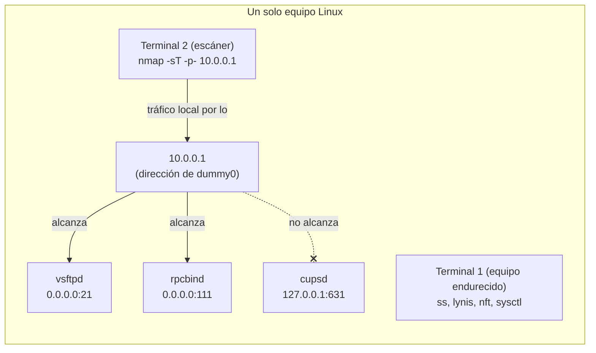
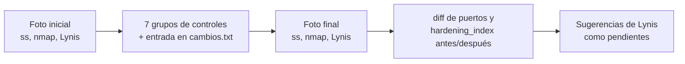
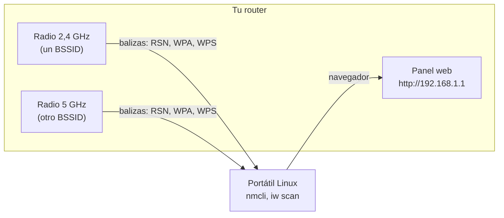

# Ejercicios: Defensa y hardening

Ejercicios guiados para hacer en tu propio equipo o laboratorio. Cada uno dice qué vas
a lograr, qué necesitas, los pasos exactos y cómo comprobar que salió bien. La teoría
está en [README.md](README.md).

## Ejercicio 1: Aplica un subconjunto del CIS nivel 1 a un equipo de laboratorio

Nodo: [Operating System Hardening](README.md#operating-system-hardening), con apoyo de [Port Blocking](README.md#port-blocking), [Host Based Firewall](README.md#host-based-firewall) y [Patching](README.md#patching).

Objetivo: endurecer un equipo Linux de laboratorio con siete grupos de controles del CIS Benchmark nivel 1, dejar un registro de cada cambio y demostrar con `ss`, `nmap` y Lynis que la superficie de ataque bajó (menos puertos en escucha, puertos filtrados desde fuera y un índice de hardening mayor). Todo en un solo equipo, usando varias terminales: no hacen falta máquinas virtuales ni una segunda máquina.

Necesitas:

- Un equipo Linux que puedas restaurar o reinstalar sin pena: idealmente un contenedor, un equipo de laboratorio o una instalación aparte, **nunca tu equipo de trabajo diario**. Sirve Ubuntu Server 24.04 LTS, Debian 12 o Arch Linux; a lo largo del ejercicio se dan los nombres de paquete y servicio de cada familia. Varios de estos controles (purgar servicios, activar el firewall, endurecer SSH) pueden dejarte sin acceso o romper el sistema si te equivocas, por eso conviene un equipo del que puedas partir de cero.
- Trabajarás con **varias terminales abiertas en el mismo equipo**:
  - **Terminal 1 (equipo endurecido)**: donde aplicas los controles y corres `ss`, `lynis`, etc.
  - **Terminal 2 (escáner)**: desde donde escaneas con `nmap` el servicio simulado "desde fuera". Es el mismo equipo; en una red real este escáner estaría en otra máquina, pero el flujo de paquetes que observas es idéntico.
- Una interfaz `dummy` que da una dirección IP que no es loopback, para poder hablar de "alcanzable desde fuera" sin una segunda máquina. Créala en la **Terminal 1** antes de empezar:
  ```bash
  sudo ip link add dummy0 type dummy
  sudo ip addr add 10.0.0.1/24 dev dummy0
  sudo ip link set dummy0 up
  ip -4 -br addr show dummy0       # debe mostrar: dummy0  UNKNOWN  10.0.0.1/24
  ```
  - `ip` → herramienta de iproute2 para consultar y configurar la red.
  - `link add dummy0 type dummy` → crea una interfaz virtual llamada `dummy0` del tipo `dummy`: existe en el kernel, acepta direcciones y tráfico, pero no sale a ninguna parte.
  - `addr add 10.0.0.1/24 dev dummy0` → le asigna la dirección `10.0.0.1` con máscara `/24` a esa interfaz.
  - `link set dummy0 up` → la activa.
  - `-4 -br addr show dummy0` → muestra en formato breve (`-br`) solo las direcciones IPv4 (`-4`) de `dummy0`.

  Los servicios que levantes en `0.0.0.0` quedarán también escuchando en `10.0.0.1`, así que `nmap 10.0.0.1` los ve como los vería un atacante de la red; los que escuchen solo en `127.0.0.1` no, igual que en una máquina real. (Como escáner y objetivo son el mismo equipo, el firewall filtrará por dirección de destino, no por interfaz, ver paso 9.)
- `nmap` en el equipo. Instalación:
  - Debian/Ubuntu: `sudo apt install nmap`
  - Arch: `sudo pacman -S nmap`
- El PDF del benchmark: regístrate gratis en [CIS Benchmarks](https://www.cisecurity.org/cis-benchmarks) y descarga "CIS Ubuntu Linux 24.04 LTS Benchmark" (sirve de guía aunque uses Arch; los controles son equivalentes). Los números de control cambian entre versiones; en este ejercicio se citan por su título, búscalos en el PDF y anota el número de tu versión.
- Tiempo estimado: 2 horas.

> [!WARNING]
> Hazlo solo en un equipo que puedas restaurar (contenedor, equipo de laboratorio o instalación aparte), nunca en tu equipo de trabajo. Algunos controles (firewall, SSH) pueden dejarte sin acceso remoto o romper servicios si te equivocas; si administras el equipo por SSH, ten siempre a mano una consola local además de la sesión remota. El firewall de este ejercicio se limita a la dirección simulada `10.0.0.1` justo para no cortar tu sesión real.

Montaje del laboratorio en un solo equipo: el escáner apunta a `10.0.0.1` y solo alcanza lo que escucha en todas las interfaces.



### Pasos

1. Simula un sistema "de fábrica" con servicios de sobra. Instala los que un escritorio o una plantilla vieja suelen traer encendidos:
   ```bash
   # Debian/Ubuntu
   sudo apt update
   sudo apt install -y vsftpd rpcbind avahi-daemon cups
   # Arch
   sudo pacman -S vsftpd rpcbind avahi cups
   sudo systemctl start vsftpd rpcbind avahi-daemon cups
   ```
   - `sudo` → ejecuta el comando que sigue como root; instalar paquetes exige privilegios de administrador.
   - `apt update` → descarga de los repositorios la lista actualizada de paquetes y versiones disponibles; no instala nada.
   - `apt install` → instala los paquetes indicados y sus dependencias.
   - `-y` → responde "sí" automáticamente a la confirmación, para no tener que escribirla.
   - `pacman -S` → instala (sincroniza) los paquetes indicados en Arch.
   - `vsftpd` → servidor FTP.
   - `rpcbind` → el portmapper que usan NFS y otros servicios RPC.
   - `avahi-daemon` / `avahi` → servicio de anuncio y descubrimiento mDNS/DNS-SD en la red local (el paquete en Arch se llama `avahi`, el servicio sigue siendo `avahi-daemon`).
   - `cups` → servidor de impresión.
   - `systemctl start vsftpd rpcbind avahi-daemon cups` → en Arch arranca los servicios con `sudo systemctl start <svc>`, porque no se inician solos al instalar (Debian suele arrancarlos durante la instalación).

   Así tendrás un FTP, el portmapper de NFS, el anuncio mDNS y el servidor de impresión, cuatro cosas que el CIS nivel 1 pide quitar si no se usan.
2. Crea la carpeta de trabajo y guarda la foto inicial de puertos TCP y UDP en escucha:
   ```bash
   mkdir -p ~/hardening
   sudo ss -tlnp | tee ~/hardening/antes-tcp.txt
   sudo ss -ulnp | tee ~/hardening/antes-udp.txt
   ss -H -tln | wc -l
   ```
   - `mkdir` → crea un directorio.
   - `-p` → crea también los directorios padre que falten y no da error si ya existe.
   - `~/hardening` → la carpeta de trabajo dentro de tu directorio personal (`~`).
   - `sudo` → ejecuta `ss` como root; hace falta para ver el nombre del proceso, sin él la columna `Process` sale vacía.
   - `ss` → muestra los sockets del sistema (sustituto moderno de `netstat`).
   - `-t` → solo sockets TCP.
   - `-u` → solo sockets UDP.
   - `-l` → solo los sockets en escucha (LISTEN).
   - `-n` → muestra direcciones y puertos en número, sin traducirlos a nombres de servicio.
   - `-p` → muestra el proceso (nombre, PID y descriptor) que usa cada socket.
   - `-H` → suprime la línea de cabecera, para que el recuento no la incluya.
   - `|` → tubería: pasa la salida del comando de la izquierda como entrada del de la derecha.
   - `tee ~/hardening/antes-tcp.txt` → muestra en pantalla lo que recibe y a la vez lo guarda en ese archivo (`antes-udp.txt` para UDP).
   - `wc -l` → cuenta las líneas que recibe, es decir, los sockets TCP en escucha.

   Salida típica (abreviada):
   ```
   LISTEN 0 32    0.0.0.0:21        users:(("vsftpd",pid=1630,fd=3))
   LISTEN 0 4096  0.0.0.0:111       users:(("rpcbind",pid=1402,fd=4))
   LISTEN 0 4096  127.0.0.1:631     users:(("cupsd",pid=1720,fd=7))
   LISTEN 0 4096  127.0.0.53%lo:53  users:(("systemd-resolve",pid=610,fd=15))
   ```
   El último comando cuenta los sockets TCP en escucha sin la cabecera (IPv4 e IPv6 por separado): ese es tu número "antes". Fíjate en la columna de dirección: `vsftpd` y `rpcbind` escuchan en `0.0.0.0` (todas las interfaces, incluida `10.0.0.1`), pero `cupsd` escucha en `127.0.0.1` (solo loopback).
3. Escanea el servicio "desde fuera". En la **Terminal 2 (escáner)**, apunta a la dirección de la interfaz `dummy0`:
   ```bash
   nmap -sT -p- 10.0.0.1 -oN ~/hardening/antes-nmap.txt
   ```
   - `nmap` → escáner de puertos.
   - `-sT` → escaneo TCP connect: completa el saludo de tres vías con cada puerto; no necesita privilegios.
   - `-p-` → escanea todos los puertos TCP, del 1 al 65535 (sin él solo revisa los 1000 más comunes).
   - `10.0.0.1` → la dirección de la interfaz `dummy0`, que hace de "red externa"; en un caso real sería la IP del equipo vista desde otra máquina.
   - `-oN ~/hardening/antes-nmap.txt` → guarda además el resultado en ese archivo en formato normal (legible).

   Deberías ver `21/tcp open ftp` y `111/tcp open rpcbind` (y `22/tcp open ssh` si tienes servidor SSH activo). El `631` de CUPS no aparece: escucha en `127.0.0.1` y no es alcanzable desde `10.0.0.1`, igual que en una máquina real un servicio en loopback no está expuesto a la red.

   > Solo contra `127.0.0.1` / `10.0.0.1` / servicios que tú mismo levantaste en este equipo. `nmap` y las demás herramientas ofensivas se usan únicamente contra tu propia máquina o sistemas que tengas autorización explícita para auditar.
4. Mide el punto de partida con Lynis (en la **Terminal 1**):
   ```bash
   # Debian/Ubuntu
   sudo apt install -y lynis
   # Arch
   sudo pacman -S lynis
   sudo lynis audit system --quick | tee ~/hardening/lynis-antes.txt
   sudo grep hardening_index /var/log/lynis-report.dat
   ```
   - `sudo apt install -y lynis` / `sudo pacman -S lynis` → instala Lynis (ver paso 1).
   - `lynis` → herramienta de auditoría de seguridad para sistemas Unix.
   - `audit system` → orden de Lynis que audita el sistema local completo.
   - `--quick` → modo rápido: no se detiene a esperar que pulses Enter entre secciones.
   - `| tee ~/hardening/lynis-antes.txt` → muestra el informe y lo guarda en ese archivo (ver paso 2).
   - `sudo` → el informe de Lynis solo lo puede leer root.
   - `grep hardening_index` → muestra solo las líneas que contienen el texto `hardening_index`.
   - `/var/log/lynis-report.dat` → informe en formato `clave=valor` que Lynis escribe al terminar cada auditoría.

   Anota el número (por ejemplo `hardening_index=61`). El valor exacto depende de la versión y de la distribución; lo que importa es compararlo consigo mismo al final.
5. Abre el registro de cambios. Cada control que apliques tendrá una entrada con este formato, en texto plano:
   ```bash
   cat > ~/hardening/cambios.txt <<'EOF'
   Registro de hardening CIS nivel 1 - equipo de laboratorio
   Formato: [control CIS (título y número de tu PDF)] antes -> cambio -> cómo se verifica

   EOF
   ```
   - `cat` → copia a su salida lo que recibe por la entrada estándar.
   - `> ~/hardening/cambios.txt` → redirige esa salida a ese archivo, creándolo o vaciándolo si ya existía.
   - `<<'EOF'` → heredoc: pasa como entrada todas las líneas que siguen hasta la línea `EOF`; las comillas simples evitan que la shell expanda `$`, comillas o comodines dentro del texto.
   - `EOF` → marca de cierre del heredoc; debe ir sola en su línea.

   Después de cada paso siguiente, añade su entrada con `nano ~/hardening/cambios.txt`.
6. Control "servicios de servidor que no se usan" (sección Services del benchmark: avahi, servidor de impresión, rpcbind, servidor FTP). Elimínalos, no solo los pares:
   ```bash
   # Debian/Ubuntu
   sudo apt purge -y vsftpd rpcbind avahi-daemon cups
   sudo apt autoremove -y
   dpkg -l vsftpd rpcbind avahi-daemon cups 2>&1 | grep -E '^ii' || echo "ninguno instalado"
   # Arch
   sudo systemctl disable --now vsftpd rpcbind avahi-daemon cups
   sudo pacman -Rns vsftpd rpcbind avahi cups
   pacman -Q vsftpd rpcbind avahi cups 2>&1 | grep -v 'was not found' || echo "ninguno instalado"
   ```
   - `sudo`, `-y` → (ver paso 1).
   - `apt purge` → desinstala los paquetes y borra también sus archivos de configuración (`remove` los dejaría).
   - `vsftpd rpcbind avahi-daemon cups` → los cuatro paquetes instalados en el paso 1 (en Arch, `avahi` en vez de `avahi-daemon`).
   - `apt autoremove` → desinstala las dependencias que se instalaron automáticamente y ya nadie necesita.
   - `dpkg -l` → lista los paquetes indicados con su estado en el sistema.
   - `2>&1` → manda también los errores (salida 2) a la salida normal (1), para que pasen por la tubería; avisa por error de los paquetes que no encuentra.
   - `grep -E '^ii'` → deja solo las líneas que empiezan (`^`) por `ii`, el estado "deseado instalar, instalado"; `-E` activa las expresiones regulares extendidas.
   - `||` → ejecuta lo de la derecha solo si lo de la izquierda falla; `grep` falla cuando no encuentra ninguna línea.
   - `echo "ninguno instalado"` → imprime ese texto.
   - `systemctl disable --now ...` → en Arch, desactiva y detiene (`--now`) los servicios antes de quitarlos; `pacman` no para los servicios por ti.
   - `pacman -Rns` → desinstala los paquetes (`-R`), con sus dependencias ya huérfanas (`-s`) y sus archivos de configuración (`-n`).
   - `pacman -Q` → consulta si cada paquete sigue instalado; `grep -v 'was not found'` descarta los avisos de los que ya no están.

   La última línea debe imprimir `ninguno instalado`. Entrada de ejemplo para el registro:
   ```
   [Ensure ftp/avahi/print/rpcbind services are not in use] 4 servicios activos -> purga de paquetes -> el gestor ya no los lista
   ```
7. Control "módulos de sistemas de archivos poco usados deshabilitados" (cramfs, freevxfs, hfs, hfsplus, jffs2). Crea el archivo completo (igual en Debian/Ubuntu y Arch):
   ```bash
   sudo tee /etc/modprobe.d/cis-filesystems.conf <<'EOF'
   # CIS L1: filesystems not needed on this server
   install cramfs /bin/false
   blacklist cramfs
   install freevxfs /bin/false
   blacklist freevxfs
   install hfs /bin/false
   blacklist hfs
   install hfsplus /bin/false
   blacklist hfsplus
   install jffs2 /bin/false
   blacklist jffs2
   EOF
   modprobe -n -v cramfs
   ```
   - `sudo` → (ver paso 1); `/etc/modprobe.d/` solo lo puede escribir root.
   - `tee /etc/modprobe.d/cis-filesystems.conf` → escribe en ese archivo lo que recibe; se usa `sudo tee` en lugar de `sudo cat >` porque la redirección `>` la haría tu shell sin privilegios.
   - `<<'EOF'` ... `EOF` → heredoc con el contenido del archivo (ver paso 5).
   - `# CIS L1: ...` → comentario dentro del archivo de configuración; modprobe lo ignora.
   - `install cramfs /bin/false` → cuando se pida cargar el módulo `cramfs`, en lugar de cargarlo ejecuta `/bin/false`, que no hace nada y termina con error.
   - `blacklist cramfs` → impide que el módulo se cargue automáticamente por alias (por ejemplo al detectar un dispositivo); solo con esto aún se podría cargar a mano, por eso va junto a `install`.
   - `freevxfs`, `hfs`, `hfsplus`, `jffs2` → los demás sistemas de archivos, con las mismas dos directivas.
   - `modprobe` → carga o descarga módulos del kernel.
   - `-n` → simulación (dry run): hace todo menos cargar el módulo.
   - `-v` → modo detallado: imprime lo que haría; debe responder `install /bin/false`, así que si alguien enchufa un disco con ese formato, el kernel no cargará el módulo.
   - `cramfs` → el módulo que se comprueba.
8. Control "parámetros de red y kernel" (secciones Network Parameters y Process Hardening). Archivo completo (igual en ambas distribuciones):
   ```bash
   sudo tee /etc/sysctl.d/60-cis.conf <<'EOF'
   # CIS L1: host is not a router
   net.ipv4.ip_forward = 0
   net.ipv4.conf.all.send_redirects = 0
   net.ipv4.conf.default.send_redirects = 0
   # CIS L1: ignore ICMP redirects and source-routed packets
   net.ipv4.conf.all.accept_redirects = 0
   net.ipv4.conf.default.accept_redirects = 0
   net.ipv4.conf.all.secure_redirects = 0
   net.ipv4.conf.default.secure_redirects = 0
   net.ipv4.conf.all.accept_source_route = 0
   net.ipv4.conf.default.accept_source_route = 0
   net.ipv6.conf.all.accept_redirects = 0
   net.ipv6.conf.default.accept_redirects = 0
   # CIS L1: log spoofed packets, reverse path filter, SYN cookies
   net.ipv4.conf.all.log_martians = 1
   net.ipv4.conf.default.log_martians = 1
   net.ipv4.conf.all.rp_filter = 1
   net.ipv4.conf.default.rp_filter = 1
   net.ipv4.icmp_echo_ignore_broadcasts = 1
   net.ipv4.icmp_ignore_bogus_error_responses = 1
   net.ipv4.tcp_syncookies = 1
   # CIS L1: process hardening
   kernel.randomize_va_space = 2
   kernel.yama.ptrace_scope = 1
   fs.suid_dumpable = 0
   EOF
   sudo sysctl --system | tail -n 5
   sysctl net.ipv4.conf.all.accept_redirects kernel.randomize_va_space
   ```
   - `sudo tee /etc/sysctl.d/60-cis.conf <<'EOF'` → escribe el archivo como root con el texto del heredoc (ver pasos 5 y 7). El prefijo `60-` fija el orden de lectura frente a otros archivos de `/etc/sysctl.d/`.
   - `# ...` → comentarios; sysctl los ignora.
   - `all` / `default` → en cada parámetro `net.ipv4.conf.*`, `all` afecta a todas las interfaces actuales y `default` a las que se creen después; por eso se fijan las dos.
   - `net.ipv4.ip_forward = 0` → el equipo no reenvía paquetes entre interfaces: no actúa como router.
   - `send_redirects = 0` → no envía mensajes ICMP Redirect (solo los manda un router).
   - `accept_redirects = 0` → ignora los ICMP Redirect recibidos, que un atacante podría usar para desviar tu tráfico.
   - `secure_redirects = 0` → ignora también los redirects que vengan de las puertas de enlace conocidas.
   - `accept_source_route = 0` → descarta paquetes con enrutamiento de origen, en los que el emisor impone la ruta.
   - `net.ipv6.conf.all.accept_redirects = 0` y `net.ipv6.conf.default.accept_redirects = 0` → lo mismo para IPv6.
   - `log_martians = 1` → registra en el log del kernel los paquetes con direcciones de origen imposibles ("marcianos"), típicos de suplantación.
   - `rp_filter = 1` → filtro de ruta inversa estricto: descarta un paquete si la respuesta no saldría por la misma interfaz por la que llegó.
   - `net.ipv4.icmp_echo_ignore_broadcasts = 1` → no responde a pings enviados a direcciones de difusión (evita ataques smurf).
   - `net.ipv4.icmp_ignore_bogus_error_responses = 1` → no registra las respuestas ICMP de error mal formadas, para que no llenen el log.
   - `net.ipv4.tcp_syncookies = 1` → activa las SYN cookies, que mantienen el servicio durante una inundación SYN.
   - `kernel.randomize_va_space = 2` → ASLR completo: aleatoriza pila, bibliotecas, mmap y también el heap.
   - `kernel.yama.ptrace_scope = 1` → un proceso solo puede depurar con `ptrace` a sus propios descendientes, no a cualquier proceso del mismo usuario.
   - `fs.suid_dumpable = 0` → los programas setuid no generan volcados de memoria (core dumps) que podrían filtrar datos privilegiados.
   - `sysctl --system` → carga los parámetros de todos los directorios de configuración del sistema, incluido el archivo nuevo.
   - `| tail -n 5` → muestra solo las últimas 5 líneas de esa salida (`-n` indica cuántas).
   - `sysctl net.ipv4.conf.all.accept_redirects kernel.randomize_va_space` → sin `=`, solo lee y muestra el valor actual de esos dos parámetros.

   La última orden debe devolver `= 0` y `= 2`. Son los mismos parámetros que el ejemplo `90-hardening.conf` del README, ampliados.
9. Control "firewall basado en host configurado" (sección Host Based Firewall). En Arch el firewall del kernel se administra con nftables; en Debian/Ubuntu `ufw` es un frente más sencillo sobre lo mismo, pero aquí usamos nftables directamente para que valga en ambas familias. Instálalo:
   ```bash
   # Debian/Ubuntu
   sudo apt install -y nftables
   # Arch
   sudo pacman -S nftables
   ```
   - `sudo apt install -y nftables` / `sudo pacman -S nftables` → instala nftables (ver paso 1). En Arch suele venir ya instalado como parte del sistema base.

   La regla "SSH primero, política después": si bloquearas antes de permitir SSH y administraras el equipo en remoto, te cortarías. Por eso la regla que acepta el 22 va antes que el descarte. Para no afectar tu sesión real, el firewall de este laboratorio se limita a la dirección simulada `10.0.0.1` (en un caso real, la política por defecto sería descartar todo lo entrante, como `ufw default deny incoming`). Crea el archivo de reglas:
   ```bash
   sudo tee /etc/nftables-cis-lab.conf > /dev/null <<'EOF'
   table inet cis_lab {
       chain input {
           type filter hook input priority 0; policy accept;
           ip daddr 10.0.0.1 tcp dport 22 accept
           ip daddr 10.0.0.1 log prefix "cis-lab drop: " drop
       }
   }
   EOF
   sudo nft -f /etc/nftables-cis-lab.conf
   sudo nft list table inet cis_lab
   ```
   - `sudo tee /etc/nftables-cis-lab.conf > /dev/null` → escribe el archivo como root; `> /dev/null` descarta la copia que `tee` manda a pantalla.
   - `table inet cis_lab` → crea una tabla llamada `cis_lab` de la familia `inet`, que cubre IPv4 e IPv6 a la vez.
   - `chain input` → cadena enganchada al tráfico entrante dirigido a esta máquina.
   - `type filter hook input priority 0` → cadena de filtrado en el hook de entrada, con la prioridad estándar 0.
   - `policy accept` → lo que no coincida con ninguna regla se acepta: así el resto del sistema no se ve afectado, solo filtramos lo dirigido a `10.0.0.1`.
   - `ip daddr 10.0.0.1 tcp dport 22 accept` → acepta primero el SSH (puerto 22) hacia la dirección simulada; va antes que el descarte para no cortar la administración (la lección del orden).
   - `ip daddr 10.0.0.1 log prefix "cis-lab drop: " drop` → todo lo demás dirigido a `10.0.0.1` se registra en el log del kernel con ese prefijo y se descarta sin responder. Se filtra por dirección de destino (no por interfaz) porque escáner y objetivo son el mismo equipo y el tráfico local llega por `lo`.
   - `nft -f /etc/nftables-cis-lab.conf` → lee y aplica las reglas del archivo de forma atómica.
   - `nft list table inet cis_lab` → muestra la tabla cargada para comprobarla.

   Si tu sistema usa `iptables` en vez de `nft`, el equivalente es:
   ```bash
   sudo iptables -A INPUT -d 10.0.0.1 -p tcp --dport 22 -j ACCEPT
   sudo iptables -A INPUT -d 10.0.0.1 -j DROP
   ```
   - `iptables` → herramienta clásica de filtrado IPv4; en Arch el camino moderno es `iptables-nft`, que traduce estas órdenes a nftables por debajo.
   - `-A INPUT` → añade la regla al final de la cadena `INPUT` (tráfico entrante).
   - `-d 10.0.0.1` → coincide con paquetes cuyo destino es la dirección simulada.
   - `-p tcp --dport 22` → protocolo TCP, puerto de destino 22 (SSH).
   - `-j ACCEPT` / `-j DROP` → acepta o descarta; la regla de ACCEPT va primero por el mismo motivo de orden.

   En Arch, para que el firewall se cargue en cada arranque, habilita el servicio con `sudo systemctl enable nftables` (Debian suele dejar la carga lista al instalar). Para este laboratorio basta con haberlo cargado a mano con `nft -f`.

   Cómo decide la cadena `input` de `cis_lab`:

   ```mermaid
   flowchart TD
       P["Paquete entrante"] --> D{"¿Destino<br/>10.0.0.1?"}
       D -->|"no"| ACC["policy accept<br/>(el resto del sistema no cambia)"]
       D -->|"sí"| S{"¿TCP puerto 22?"}
       S -->|"sí"| OK["accept"]
       S -->|"no"| DR["log 'cis-lab drop: '<br/>y drop sin respuesta"]
   ```

10. Control "configuración del servidor SSH" (sección SSH Server). En Ubuntu 24.04, Debian 12 y Arch con OpenSSH reciente, `sshd_config` incluye `sshd_config.d/*.conf`, y en sshd gana el primer valor leído, así que un archivo ahí manda sobre el resto. Archivo completo:
    ```bash
    sudo tee /etc/ssh/sshd_config.d/10-cis.conf <<'EOF'
    # CIS L1 SSH server settings
    PermitRootLogin no
    PermitEmptyPasswords no
    PermitUserEnvironment no
    HostbasedAuthentication no
    IgnoreRhosts yes
    MaxAuthTries 4
    MaxSessions 10
    MaxStartups 10:30:60
    LoginGraceTime 60
    ClientAliveInterval 15
    ClientAliveCountMax 3
    DisableForwarding yes
    LogLevel VERBOSE
    Banner /etc/issue.net
    EOF
    sudo chmod 600 /etc/ssh/sshd_config /etc/ssh/sshd_config.d/10-cis.conf
    sudo sshd -t && sudo systemctl reload sshd    # Debian/Ubuntu: la unidad se llama ssh
    sudo sshd -T | grep -E '^(permitrootlogin|maxauthtries|disableforwarding|loglevel) '
    ```
    - `sudo tee /etc/ssh/sshd_config.d/10-cis.conf <<'EOF'` → escribe el archivo como root con el texto del heredoc (ver pasos 5 y 7); el prefijo `10-` hace que se lea antes que otros archivos del directorio. (Si tu OpenSSH es antiguo y `sshd_config` no tiene la línea `Include`, añade estas directivas al final de `/etc/ssh/sshd_config`.)
    - `# CIS L1 SSH server settings` → comentario; sshd lo ignora.
    - `PermitRootLogin no` → root no puede iniciar sesión por SSH de ninguna forma.
    - `PermitEmptyPasswords no` → rechaza el acceso a cuentas con contraseña vacía.
    - `PermitUserEnvironment no` → ignora `~/.ssh/environment` y las opciones `environment=` de `authorized_keys`, con las que un usuario podría inyectar variables como `LD_PRELOAD`.
    - `HostbasedAuthentication no` → desactiva la autenticación basada en la máquina de origen (estilo rhosts).
    - `IgnoreRhosts yes` → ignora los archivos `.rhosts` y `.shosts` de los usuarios.
    - `MaxAuthTries 4` → como máximo 4 intentos de autenticación por conexión; a partir de la mitad, los fallos se registran.
    - `MaxSessions 10` → como máximo 10 sesiones (shell, sftp) multiplexadas dentro de una misma conexión.
    - `MaxStartups 10:30:60` → con 10 conexiones sin autenticar, rechaza las nuevas con un 30 % de probabilidad, que sube linealmente hasta rechazar todas al llegar a 60.
    - `LoginGraceTime 60` → corta la conexión si en 60 segundos no se ha autenticado.
    - `ClientAliveInterval 15` → si el cliente no envía nada en 15 segundos, sshd le manda un mensaje por el canal cifrado pidiendo respuesta.
    - `ClientAliveCountMax 3` → tras 3 de esos mensajes sin respuesta, desconecta (sesión muerta en unos 45 segundos).
    - `DisableForwarding yes` → desactiva todo reenvío: X11, puertos TCP y sockets Unix.
    - `LogLevel VERBOSE` → registra más detalle que el nivel por defecto `INFO`, entre otras cosas la huella de la clave usada en cada login.
    - `Banner /etc/issue.net` → envía el contenido de ese archivo (aviso legal) antes de la autenticación.
    - `chmod 600` → deja los permisos en lectura y escritura solo para el dueño (root), sin acceso para grupo ni otros.
    - `/etc/ssh/sshd_config /etc/ssh/sshd_config.d/10-cis.conf` → los dos archivos a los que se aplica.
    - `sshd -t` → modo prueba: valida la sintaxis de la configuración y las claves, y no imprime nada si todo está bien.
    - `&&` → ejecuta lo de la derecha solo si lo de la izquierda terminó bien; así solo se recarga si la configuración es válida.
    - `systemctl reload sshd` → pide al servicio que relea su configuración sin cortar las sesiones abiertas; en Arch y Fedora la unidad se llama `sshd`, en Ubuntu y Debian se llama `ssh`. En Arch, si nunca arrancaste el servidor, actívalo con `sudo systemctl start sshd` (Debian suele arrancarlo al instalar `openssh-server`).
    - `sshd -T` → modo prueba extendido: valida y escribe la configuración efectiva completa, una directiva por línea en minúsculas.
    - `grep -E '^(permitrootlogin|maxauthtries|disableforwarding|loglevel) '` → deja solo las líneas que empiezan (`^`) por una de esas directivas seguida de espacio; `-E` permite usar el grupo `( | )` de alternativas.

    Antes de cerrar tu sesión actual, si administras el equipo por SSH abre una segunda con `ssh usuario@127.0.0.1` (o `ssh usuario@10.0.0.1`, que el firewall del paso 9 permite) para confirmar que sigues entrando.

    ```mermaid
    flowchart TD
        W["Escribir 10-cis.conf"] --> T{"sudo sshd -t<br/>¿sin errores?"}
        T -->|"no"| F["Corregir el archivo"]
        F --> T
        T -->|"sí"| R["systemctl reload<br/>(ssh o sshd)"]
        R --> V["sshd -T muestra<br/>la configuración efectiva"]
        V --> C["Segunda sesión ssh a 127.0.0.1<br/>antes de cerrar la actual"]
    ```

11. Control "permisos de archivos de cuentas" (sección System File Permissions). Comprueba y, si hiciera falta, corrige:
    ```bash
    stat -c '%a %U:%G %n' /etc/passwd /etc/group /etc/shadow /etc/gshadow
    ```
    - `stat` → muestra los metadatos de un archivo.
    - `-c '...'` → usa el formato indicado en lugar de la salida completa.
    - `%a` → permisos en octal (por ejemplo `644`).
    - `%U` → nombre del usuario dueño.
    - `%G` → nombre del grupo dueño.
    - `%n` → nombre del archivo.
    - `/etc/passwd /etc/group /etc/shadow /etc/gshadow` → los cuatro archivos de cuentas y grupos que se revisan.

    Lo esperado es `644 root:root` para `passwd` y `group`, y `640 root:shadow` (o más restrictivo) para `shadow` y `gshadow`. En Arch el grupo de `shadow` suele ser `root` y los permisos `600`, que es igual de válido o más restrictivo. Si alguno no cuadra: `sudo chmod 640 /etc/shadow && sudo chown root:shadow /etc/shadow` (`chmod 640` deja lectura y escritura al dueño y solo lectura al grupo; `chown root:shadow` pone como dueño a `root` y como grupo a `shadow`).
12. Control "control de acceso obligatorio" y "parches al día" (secciones Mandatory Access Control y Software Updates):
    ```bash
    # Debian/Ubuntu: AppArmor viene activo
    sudo aa-status | head -n 4
    sudo apt update && sudo apt full-upgrade -y
    ls /var/run/reboot-required 2>/dev/null && sudo reboot
    # Arch: ni AppArmor ni SELinux vienen activos de fábrica
    sudo pacman -Syu
    ```
    - `sudo` → (ver paso 1); `aa-status` necesita root para leer el estado de AppArmor.
    - `aa-status` → muestra si el módulo AppArmor está cargado y cuántos perfiles hay en modo enforce y complain; en Debian/Ubuntu debe decir `apparmor module is loaded.` y un número de perfiles cargados. En Arch, AppArmor (o SELinux) no viene activo: el control equivalente exige instalarlo y habilitarlo aparte (`apparmor`, parámetros del kernel `lsm=...`), lo cual queda fuera de este ejercicio; anótalo como pendiente si usas Arch.
    - `| head -n 4` → muestra solo las 4 primeras líneas (`-n` indica cuántas).
    - `apt update` → (ver paso 1).
    - `&&` → (ver paso 10).
    - `apt full-upgrade` → instala todas las actualizaciones disponibles y, si hace falta, instala o quita paquetes para completarlas (por ejemplo un kernel nuevo).
    - `-y` → (ver paso 1).
    - `ls /var/run/reboot-required` → lista ese archivo, que Ubuntu crea cuando una actualización exige reiniciar; si no existe, `ls` falla.
    - `2>/dev/null` → descarta el mensaje de error de `ls` cuando el archivo no existe.
    - `sudo reboot` → reinicia el sistema; solo se ejecuta si el archivo existe, gracias a `&&`.
    - `pacman -Syu` → en Arch, sincroniza las listas (`-y`) y actualiza todo el sistema (`-u`) en una sola orden; Arch no crea un archivo `reboot-required`, así que reinicia tú mismo si se actualizó el kernel (compáralo con `uname -r` frente a la versión instalada).

    Si existe `/var/run/reboot-required` (o acabas de actualizar el kernel en Arch), el parche no protege hasta reiniciar, igual que explica la sección Patching.
13. Toma la foto final. En la **Terminal 1**:
    ```bash
    sudo ss -tlnp | tee ~/hardening/despues-tcp.txt
    sudo ss -ulnp | tee ~/hardening/despues-udp.txt
    ss -H -tln | wc -l
    diff ~/hardening/antes-tcp.txt ~/hardening/despues-tcp.txt
    ```
    - `sudo ss -tlnp | tee ...`, `sudo ss -ulnp | tee ...`, `ss -H -tln | wc -l` → (ver paso 2), ahora guardando en `despues-tcp.txt` y `despues-udp.txt`.
    - `diff` → compara dos archivos línea a línea y muestra solo las diferencias: las líneas con `<` estaban solo antes y las de `>` solo después.
    - `~/hardening/antes-tcp.txt ~/hardening/despues-tcp.txt` → el archivo antiguo y el nuevo.

    Y vuelve a escanear desde la **Terminal 2 (escáner)**:
    ```bash
    nmap -sT -p- 10.0.0.1 -oN ~/hardening/despues-nmap.txt
    ```
    - `nmap -sT -p- 10.0.0.1` → (ver paso 3).
    - `-oN ~/hardening/despues-nmap.txt` → (ver paso 3), ahora con el archivo "después".

    En el equipo deberían quedar solo el 22 (si tienes SSH) y los 53 de `systemd-resolved` en loopback. Desde `10.0.0.1`, nmap ya no debe mostrar el 21 ni el 111; si pruebas un puerto concreto que antes estaba abierto (`nmap -sT -p 21,111 10.0.0.1`, donde `-p 21,111` limita el escaneo a esos dos puertos) aparecerá `filtered`, porque la regla `drop` de nftables descarta sin responder.

    Lo que ve `nmap` en el escaneo final, con la tabla `cis_lab` cargada:

    ```mermaid
    sequenceDiagram
        participant N as nmap (Terminal 2)
        participant K as Kernel (nftables, cis_lab)
        participant S as sshd :22
        N->>K: SYN a 10.0.0.1:22
        K->>S: accept (primera regla)
        S-->>N: SYN-ACK
        Note over N: 22/tcp open
        N->>K: SYN a 10.0.0.1:21
        Note over K: log "cis-lab drop" y drop
        Note over N: Sin respuesta, 21/tcp filtered
    ```

14. Mide otra vez con Lynis y compara:
    ```bash
    sudo lynis audit system --quick | tee ~/hardening/lynis-despues.txt
    sudo grep hardening_index /var/log/lynis-report.dat
    ```
    - `sudo lynis audit system --quick | tee ...` → (ver paso 4), ahora guardando en `lynis-despues.txt`.
    - `sudo grep hardening_index /var/log/lynis-report.dat` → (ver paso 4).

    Copia a `cambios.txt` las dos cifras, el número de puertos TCP antes y después, y las primeras tres sugerencias que Lynis siga dando (`sudo grep suggestion /var/log/lynis-report.dat | head -n 3`: las líneas con `suggestion` del informe, quedándote con las 3 primeras): son tu lista de pendientes.

### Resultado esperado

Una carpeta `~/hardening/` con `antes-*.txt`, `despues-*.txt`, `lynis-antes.txt`, `lynis-despues.txt` y `cambios.txt` con una entrada por control (siete grupos). En cifras, algo como: varios sockets TCP en escucha menos (desaparecen 21, 111 y 631, en sus versiones IPv4 e IPv6), de 2 puertos abiertos desde `10.0.0.1` (21 y 111) a ninguno (salvo el 22 si usas SSH), y un índice de Lynis varios puntos más alto (el README pone como ejemplo de 58 a 77).



### Comprueba que lo lograste

- ¿Por qué `nmap` desde `10.0.0.1` nunca mostró el puerto 631 de CUPS, ni antes ni después? Porque escuchaba en `127.0.0.1`: solo era alcanzable desde el propio equipo, no desde una dirección de red. Un servicio en loopback no está expuesto, aunque sí suma superficie local.
- ¿Qué diferencia hay entre un puerto que aparece `closed` y uno `filtered` en el escaneo final? `closed` significa que el sistema respondió RST porque nadie escucha; `filtered`, que el firewall descartó el paquete y no hubo respuesta.
- `sudo sshd -T | grep permitrootlogin` devuelve `permitrootlogin no`, e intentar `ssh root@127.0.0.1` falla aunque la contraseña de root fuera correcta.
- `modprobe -n -v hfsplus` devuelve `install /bin/false`.
- Cada línea de `cambios.txt` dice qué había antes, qué cambiaste y con qué comando se verifica. Si alguna no tiene verificación, el control no está documentado.

### Limpieza

```bash
sudo nft delete table inet cis_lab          # o, con iptables: borra las dos reglas con -D en vez de -A
sudo rm -f /etc/nftables-cis-lab.conf /etc/modprobe.d/cis-filesystems.conf /etc/sysctl.d/60-cis.conf /etc/ssh/sshd_config.d/10-cis.conf
sudo ip link del dummy0
rm -f ~/hardening/antes-nmap.txt ~/hardening/despues-nmap.txt
```
- `nft delete table inet cis_lab` → borra la tabla del firewall con todas sus cadenas y reglas.
- `rm -f ...` → borra los archivos de configuración que creaste y los dos informes de nmap; `-f` no se queja si falta alguno.
- `ip link del dummy0` → elimina la interfaz virtual que creaste en Necesitas.

Si montaste el equipo solo para este ejercicio (contenedor o instalación aparte), lo más limpio para repetirlo es restaurarlo o reinstalarlo, o conservarlo endurecido como plantilla para otros laboratorios.

## Ejercicio 2: Audita el cifrado y el WPS de tu router

Nodos: [WPA vs WPA2 vs WPA3 vs WEP](README.md#wpa-vs-wpa2-vs-wpa3-vs-wep) y [WPS](README.md#wps).

Objetivo: comprobar desde fuera, con lo que tu router anuncia por el aire, que tu red usa WPA3 o WPA2 con AES-CCMP (sin WEP ni TKIP) y que no anuncia WPS; corregir en el panel lo que no cumpla y repetir la medición para demostrar el cambio.

Necesitas:

- Tu propio router doméstico y su contraseña de administración (suele venir en la etiqueta inferior si nunca la cambiaste). Solo tu red: no audites redes ajenas, aunque el escaneo pasivo las muestre.
- Un portátil Linux con Wi-Fi y NetworkManager (`nmcli` viene con él) y la herramienta `iw`:
  - Debian/Ubuntu: `sudo apt install iw`
  - Arch: `sudo pacman -S iw`
- Tiempo estimado: 30 minutos.

Qué mide cada herramienta: el portátil lee lo que el router anuncia por el aire y el navegador cambia su configuración.



### Pasos

1. Localiza tu interfaz Wi-Fi y la IP del router:
   ```bash
   nmcli -f DEVICE,TYPE,STATE device
   ip route show default
   ```
   - `nmcli` → cliente de línea de comandos de NetworkManager.
   - `-f DEVICE,TYPE,STATE` → (`--fields`) muestra solo esas columnas: nombre de la interfaz, tipo y estado.
   - `device` → objeto `device`: sin más argumentos, lista las interfaces de red.
   - `ip` → (ver ejercicio 1).
   - `route show` → muestra la tabla de rutas.
   - `default` → limita la salida a la ruta por defecto, la que apunta al router.

   La interfaz es la de tipo `wifi` (por ejemplo `wlan0` o `wlp2s0`); la IP del router es la que va tras `via` (por ejemplo `default via 192.168.1.1 dev wlan0`).
2. Mira qué seguridad anuncia tu red, sin tocar todavía el panel:
   ```bash
   nmcli -f IN-USE,SSID,BSSID,CHAN,SECURITY,WPA-FLAGS,RSN-FLAGS device wifi list --rescan yes
   ```
   - `nmcli -f` → (ver paso 1), ahora con las columnas siguientes.
   - `IN-USE` → marca con `*` la red a la que estás conectado.
   - `SSID` → nombre de la red.
   - `BSSID` → dirección MAC del radio que emite.
   - `CHAN` → canal Wi-Fi.
   - `SECURITY` → resumen de la seguridad anunciada (WEP, WPA1, WPA2, WPA3).
   - `WPA-FLAGS` → cifrados y autenticación anunciados en el elemento WPA (versión 1).
   - `RSN-FLAGS` → cifrados y autenticación anunciados en el elemento RSN (WPA2 y WPA3).
   - `device wifi list` → lista los puntos de acceso Wi-Fi visibles.
   - `--rescan yes` → fuerza un escaneo nuevo en lugar de usar la lista guardada.

   Cada fila es un BSSID (un radio del router); muchos routers tienen uno en 2,4 GHz y otro en 5 GHz con el mismo nombre, y pueden tener configuraciones distintas: revisa todas las filas de tu SSID. Cómo leer las columnas:
   ```
   SECURITY   WPA-FLAGS                 RSN-FLAGS
   WPA2 WPA3  (none)                    pair_ccmp group_ccmp psk sae      <- bien: transición WPA2/WPA3, solo AES
   WPA3       (none)                    pair_ccmp group_ccmp sae          <- ideal
   WPA1 WPA2  pair_tkip group_tkip psk  pair_tkip pair_ccmp group_tkip psk <- mal: admite WPA y TKIP
   WEP        (none)                    (none)                            <- mal: roto
   ```
   `pair_tkip` o `group_tkip` en cualquier columna, `WPA1` o `WEP` en `SECURITY` significan que hay que corregir. `psk` es WPA2-Personal; `sae` es WPA3-Personal.
3. Comprueba el WPS. Un router con WPS activo incluye un bloque WPS en sus balizas; `iw` lo muestra (cambia `wlan0` y `MiRed` por los tuyos):
   ```bash
   sudo iw dev wlan0 scan ssid "MiRed" | grep -E '^BSS|SSID:|RSN:|WPA:|WPS:|Pairwise ciphers|Authentication suites|Protected Setup State|AP setup locked'
   ```
   - `sudo` → (ver ejercicio 1); lanzar un escaneo con `iw` requiere root.
   - `iw` → herramienta para consultar y configurar interfaces inalámbricas del kernel (nl80211).
   - `dev wlan0` → actúa sobre la interfaz `wlan0`; pon la tuya.
   - `scan` → lanza un escaneo y muestra todo lo que anuncia cada BSS, incluidos los elementos RSN, WPA y WPS.
   - `ssid "MiRed"` → escaneo dirigido solo a ese nombre de red; las comillas permiten nombres con espacios.
   - `grep -E '...'` → deja solo las líneas que contengan alguna de las alternativas separadas por `|`; `-E` activa las expresiones regulares extendidas.
   - `^BSS` → línea que empieza (`^`) por `BSS`: inicio de cada punto de acceso.
   - `SSID:` → nombre de la red.
   - `RSN:` → bloque de seguridad WPA2/WPA3.
   - `WPA:` → bloque de seguridad WPA (versión 1).
   - `WPS:` → bloque WPS: si aparece, el WPS está activo.
   - `Pairwise ciphers` → cifrados para el tráfico unicast (CCMP es AES; TKIP es el antiguo).
   - `Authentication suites` → método de autenticación (PSK para WPA2-Personal, SAE para WPA3-Personal).
   - `Protected Setup State` → estado de configuración WPS.
   - `AP setup locked` → indica si el router bloqueó el PIN WPS tras demasiados intentos.

   Fragmento de un router mal configurado:
   ```
   BSS a4:2b:b0:11:22:33(on wlan0)
           SSID: MiRed
           RSN:     * Version: 1
                    * Pairwise ciphers: TKIP CCMP
                    * Authentication suites: PSK
           WPS:     * Version: 1.0
                    * Wi-Fi Protected Setup State: 2 (Configured)
   ```
   Si aparece una línea `WPS:` en tu BSS, el WPS está activo. `Pairwise ciphers: TKIP CCMP` confirma lo que viste en el paso 2. Guarda esta salida en `antes-wifi.txt` añadiendo `| tee antes-wifi.txt` al final.
4. Entra al panel del router desde un equipo conectado a él: abre en el navegador `http://192.168.1.1` (la IP del paso 1). Los menús cambian según el fabricante, pero las opciones tienen nombres parecidos:
   - Si la contraseña de administración es la de fábrica, cámbiala primero (suele estar en Administración, Sistema o Gestión).
   - En Inalámbrico, Seguridad inalámbrica (Wireless, Wireless Security): modo `WPA3-Personal`, o `WPA2/WPA3-Personal` (transición) si tienes dispositivos antiguos que no soportan WPA3. Cifrado `AES` o `CCMP`, nunca `TKIP` ni `TKIP+AES`. Si existe la opción PMF (Protected Management Frames), ponla en `Capable` (transición) o `Required` (solo WPA3).
   - Contraseña Wi-Fi de 15 caracteres o más, como recomienda el TIP del README.
   - En el menú WPS (a veces dentro de Inalámbrico o Avanzado): desactívalo por completo, no solo el PIN.
   - Aplica la configuración en cada banda (2,4 GHz y 5 GHz) si el router las separa, guarda y espera a que reinicie el Wi-Fi.
5. Reconecta tu portátil y repite la medición:
   ```bash
   nmcli -f IN-USE,SSID,BSSID,SECURITY,WPA-FLAGS,RSN-FLAGS device wifi list --rescan yes
   sudo iw dev wlan0 scan ssid "MiRed" | grep -E '^BSS|SSID:|RSN:|WPA:|WPS:|Pairwise ciphers|Authentication suites' | tee despues-wifi.txt
   nmcli -g 802-11-wireless-security.key-mgmt connection show "MiRed"
   ```
   - `nmcli -f IN-USE,SSID,BSSID,SECURITY,WPA-FLAGS,RSN-FLAGS device wifi list --rescan yes` → (ver paso 2), sin la columna `CHAN`.
   - `sudo iw dev wlan0 scan ssid "MiRed" | grep -E '...'` → (ver paso 3), con un patrón más corto.
   - `| tee despues-wifi.txt` → muestra la salida y la guarda en ese archivo (ver ejercicio 1).
   - `-g 802-11-wireless-security.key-mgmt` → (`--get-values`) imprime solo el valor de ese campo, sin nombre ni formato; `key-mgmt` es el método de gestión de claves de la conexión guardada.
   - `connection show "MiRed"` → muestra la configuración del perfil de conexión con ese nombre.

   Ahora no debe salir ninguna línea `WPS:`, `Pairwise ciphers` debe decir solo `CCMP`, y la última orden indica cómo se autentica tu propio equipo: `sae` (WPA3) o `wpa-psk` (WPA2). Si NetworkManager guardó la red como `wpa-psk` pero el router ya ofrece SAE, borra la conexión y vuelve a unirte para que negocie WPA3: `nmcli connection delete "MiRed"` (borra el perfil guardado) y `nmcli --ask device wifi connect "MiRed"` (`device wifi connect` se une a esa red y `--ask` te pide por teclado la contraseña que falta).
6. Compara las dos capturas y anótalo:
   ```bash
   diff antes-wifi.txt despues-wifi.txt
   ```
   - `diff` → (ver ejercicio 1).
   - `antes-wifi.txt despues-wifi.txt` → la captura del paso 3 y la del paso 5.
   Debe verse desaparecer el bloque `WPS:` y `TKIP`, y aparecer `SAE` en `Authentication suites` si activaste WPA3.

   Criterio para cada fila de tu SSID, antes y después del cambio:

   ```mermaid
   flowchart TD
       S["Fila de tu SSID<br/>(cada BSSID)"] --> W{"¿WEP o WPA1<br/>en SECURITY?"}
       W -->|"sí"| FIX["Corregir en el panel"]
       W -->|"no"| T{"¿tkip en WPA-FLAGS<br/>o RSN-FLAGS?"}
       T -->|"sí"| FIX
       T -->|"no"| P{"¿Bloque WPS:<br/>en iw scan?"}
       P -->|"sí"| FIX
       P -->|"no"| OK["Cumple: solo AES-CCMP<br/>con psk o sae, sin WPS"]
       FIX --> M["Repetir la medición"]
       M --> S
   ```

### Resultado esperado

Dos archivos, `antes-wifi.txt` y `despues-wifi.txt`, que demuestran con lo que el router anuncia (no con lo que dice el panel) que tu red usa solo AES-CCMP con PSK o SAE y que el WPS ya no se anuncia. Si tu router no ofrece WPA3 ni permite desactivar WPS, la conclusión es igual de útil: anota el modelo y la versión de firmware y busca en la web del fabricante si hay actualización, o considera cambiar de router.

### Comprueba que lo lograste

- `nmcli -f SSID,RSN-FLAGS device wifi list` no muestra `tkip` en ninguna fila de tu SSID.
- La salida de `iw` no contiene ninguna línea `WPS:` para ninguno de tus BSSID.
- ¿Por qué desactivar WPS aunque tu contraseña tenga 20 caracteres? Porque el PIN se valida en dos mitades: como máximo 11.000 intentos (o segundos con Pixie Dust) y el router entrega la contraseña WPA2 a quien lo acierte.
- ¿Qué gana tu red al pasar de `psk` a `sae`? Que capturar el intercambio ya no permite probar contraseñas sin conexión, más secreto hacia adelante y PMF obligatorio contra desautenticaciones.
- Tras la próxima actualización de firmware del router, repite el paso 3: algunos fabricantes reactivan WPS al actualizar.
