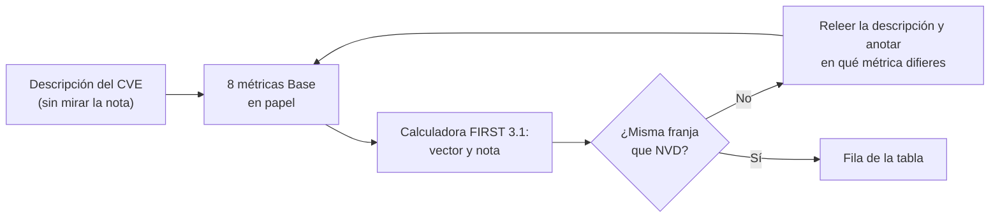
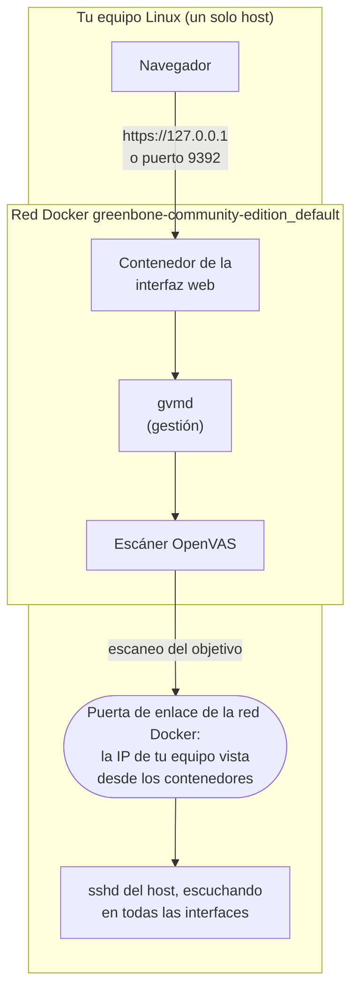
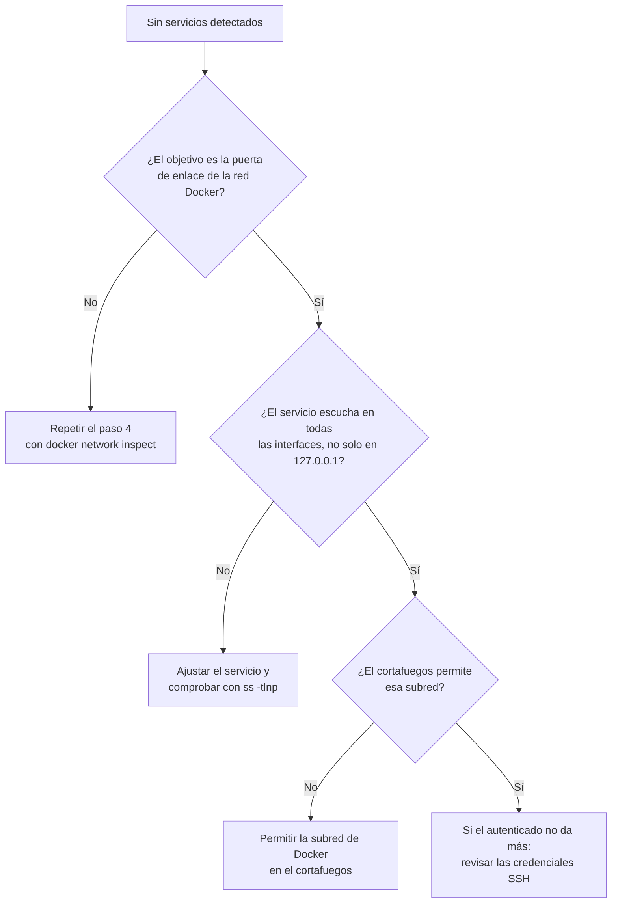
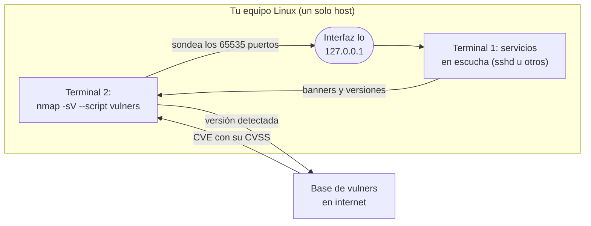
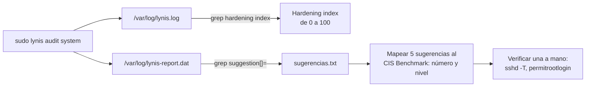

# Ejercicios: Estándares y cumplimiento

Ejercicios guiados para hacer en tu propio equipo o laboratorio. Cada uno dice qué vas
a lograr, qué necesitas, los pasos exactos y cómo comprobar que salió bien. La teoría
está en [README.md](README.md).

Todo el escaneo va contra tu propio equipo (`127.0.0.1` y los servicios que tú mismo
levantaste en esta máquina), nunca contra sistemas de terceros. No hace falta ninguna
máquina virtual: cada ejercicio se hace en este equipo con varias terminales abiertas a
la vez.

## Ejercicio 1: Recalcula el vector CVSS de tres CVE

Nodo: [CVSS](README.md#cvss).

Objetivo: dado el texto de tres CVE reales, reconstruir el vector CVSS 3.1 (y uno en
4.0) métrica a métrica y obtener una nota que caiga en la misma franja de severidad que
la oficial de NVD (None, Low, Medium, High o Critical), explicando de dónde sale cada
letra.

Necesitas: solo un navegador. Las calculadoras oficiales de FIRST
([3.1](https://www.first.org/cvss/calculator/3.1), [4.0](https://www.first.org/cvss/calculator/4.0))
y la base [NVD](https://nvd.nist.gov/vuln/search). Tiempo: 45-60 min. No instalas nada.

Método para cada CVE:



### Pasos

1. Elige tres CVE de perfiles distintos para que el ejercicio no sea repetitivo. Una
   terna recomendada: `CVE-2021-44228` (Log4Shell, ejecución remota por red),
   `CVE-2014-0160` (Heartbleed, fuga de memoria sin autenticación) y `CVE-2016-5195`
   (Dirty COW, escalada local). Abre cada uno en NVD:
   `https://nvd.nist.gov/vuln/detail/CVE-2021-44228`.
2. Lee solo la descripción del CVE, sin mirar todavía el apartado "CVSS Severity".
   Tápalo o desplázate sin leerlo.
3. Para cada CVE, responde en papel las ocho métricas Base de 3.1 a partir de la
   descripción:
   - AV (Attack Vector): ¿el atacante está en la red (N), en la red adyacente (A), es
     local (L) o físico (P)?
   - AC (Attack Complexity): ¿sin condiciones especiales (L) o con ellas (H)?
   - PR (Privileges Required): ¿ninguno (N), bajos (L) o altos (H)?
   - UI (User Interaction): ¿ninguna (N) o requiere que la víctima actúe (R)?
   - S (Scope): ¿el fallo afecta solo a su componente (U) o salta a otro (C)?
   - C, I, A: impacto en confidencialidad, integridad y disponibilidad: H, L o N.
4. Entra en la calculadora 3.1, marca esas opciones y anota la nota y el vector que te
   genera.
   ```
   CVSS:3.1/AV:N/AC:L/PR:N/UI:N/S:C/C:H/I:H/A:H  ->  10.0 Critical
   ```
   El vector resume tus elecciones; la nota es el número de 0,0 a 10,0.
5. Ahora sí, vuelve a NVD y compara tu vector con el oficial ("CVSS 3.x Severity and
   Metrics"). Anota en qué métricas difieres y por qué (relee la descripción).
6. Repite el CVE que más te costó en la calculadora 4.0 y observa que las métricas
   cambian de nombre (por ejemplo, el impacto se separa en Vulnerable System y
   Subsequent System) aunque las franjas de severidad son las mismas.

### Resultado esperado

Una tabla tuya con tres filas (CVE, tu vector, tu nota, nota oficial, franja) y una
nota corta por métrica donde no coincidiste.

### Comprueba que lo lograste

- ¿La franja de severidad (Low/Medium/High/Critical) de tus tres notas coincide con la
  de NVD? Para Log4Shell debe darte Critical (9,0-10,0); para Dirty COW, por ser local
  (AV:L), debe quedar por debajo de la de un fallo remoto equivalente.
- ¿Sabes explicar por qué Dirty COW no llega a 10,0 aunque da control total? Respuesta:
  AV:L baja la nota frente a un AV:N.

## Ejercicio 2: Escaneo con y sin credenciales usando Greenbone

Nodo: [Escáneres de vulnerabilidades](README.md#escáneres-de-vulnerabilidades) y
[Ciclo de gestión de vulnerabilidades](README.md#ciclo-de-gestión-de-vulnerabilidades).

Objetivo: escanear tu propio equipo dos veces, una sin credenciales y otra con
credenciales, comprobar que el escaneo autenticado encuentra más hallazgos, y priorizar
los cinco primeros cruzándolos con CISA KEV y EPSS.

Necesitas: tu propio equipo Linux con Docker, donde levantarás Greenbone Community
Edition en contenedores; el objetivo del escaneo es este mismo equipo. Tiempo: 2-3 h (la
primera sincronización de feeds de Greenbone tarda). Todo es local, sin ninguna máquina
virtual: Greenbone (el escáner) y el objetivo conviven en tu máquina. En un entorno real
el escáner y el objetivo estarían en equipos distintos, pero el flujo de escaneo que
observas es el mismo; aquí ambos papeles los hace tu propio host. Trabajarás con dos
terminales: la **Terminal 1 (Greenbone)**, para levantar el stack y seguir sus logs, y la
**Terminal 2 (operador)**, para los comandos sueltos y las consultas de KEV/EPSS.

Montaje del ejercicio, todo en un solo equipo:



```bash
sudo apt install docker.io     # Debian/Ubuntu
sudo pacman -S docker          # Arch
```

- `apt install docker.io` / `pacman -S docker` → instala el motor de contenedores Docker (en Arch el paquete se llama `docker`).
- En Arch arranca el servicio con `sudo systemctl start docker` (Debian suele arrancarlo solo al instalar).
- Para usar `docker` sin `sudo`, añádete al grupo `docker` con `sudo usermod -aG docker $USER` y vuelve a iniciar sesión; si no, antepón `sudo` a cada comando `docker`.

### Pasos

1. En la Terminal 1, arranca Docker y comprueba que responde:
   ```bash
   sudo systemctl start docker
   docker info
   ```
   - `systemctl start docker` → arranca el motor de Docker si no estaba activo; en Debian/Ubuntu suele estarlo ya tras instalar.
   - `docker info` → imprime el estado del motor; si sale la información del servidor, Docker funciona. El objetivo del escaneo será tu propio equipo, al que los contenedores de Greenbone llegan por la puerta de enlace de su red Docker; averiguarás esa dirección en el paso 4, cuando el stack ya exista.
2. Levanta Greenbone Community Edition con los contenedores oficiales (lo dicta la
   [documentación de Greenbone](https://greenbone.github.io/docs/latest/22.4/container/)):
   ```bash
   mkdir ~/greenbone && cd ~/greenbone
   curl -f -L https://greenbone.github.io/docs/latest/_static/compose.yaml \
     -o docker-compose.yml
   docker compose -f docker-compose.yml -p greenbone-community-edition pull
   docker compose -f docker-compose.yml -p greenbone-community-edition up -d
   ```
   - `mkdir ~/greenbone` → crea el directorio de trabajo.
   - `&& cd ~/greenbone` → si lo anterior tuvo éxito, entra en él.
   - `curl` → descarga un recurso por HTTP(S).
   - `-f` → falla sin producir salida ante errores HTTP del servidor (fail).
   - `-L` → sigue las redirecciones.
   - la URL → el archivo compose oficial de Greenbone (`compose.yaml`; el antiguo `docker-compose-22.4.yml` ya no existe y da 404). Greenbone pide usar siempre la última versión de este archivo.
   - `-o docker-compose.yml` → guarda la descarga con ese nombre.
   - `docker compose` → orquesta los contenedores definidos en un archivo compose.
   - `-f docker-compose.yml` → usa ese archivo de compose.
   - `-p greenbone-community-edition` → nombre de proyecto con el que se agrupan los contenedores.
   - `pull` → descarga las imágenes de los contenedores.
   - `up -d` → crea y arranca los contenedores; `-d` los deja corriendo en segundo plano (detached).

   Espera a que los feeds terminen de sincronizar (`docker compose ... logs -f` deja de
   mostrar descargas); puede tardar 30-60 min la primera vez.
3. Entra a la interfaz web en `https://127.0.0.1` (también responde en el puerto 9392; el
   navegador avisará del certificado autofirmado, acéptalo). El compose crea por defecto el
   usuario `admin` con contraseña `admin`. Cámbiala antes de seguir:
   ```bash
   docker compose -f docker-compose.yml -p greenbone-community-edition \
     exec -u gvmd gvmd gvmd --user=admin --new-password='TuClaveNueva'
   ```
   - `exec` → ejecuta un comando dentro de un contenedor que ya está corriendo.
   - `-u gvmd` → lo ejecuta como el usuario `gvmd` del contenedor.
   - `gvmd` (el segundo) → el servicio del compose donde se ejecuta.
   - `gvmd --user=admin --new-password='...'` → el demonio de gestión de Greenbone cambia la contraseña del usuario `admin`; las comillas simples evitan que el shell interprete caracteres como `$`.

   Inicia sesión con `admin` y la clave nueva. En el menú `Configuration > Credentials`
   crea unas credenciales SSH válidas de tu propio equipo (un usuario local de este host,
   con el servidor SSH escuchando; valen para el escaneo autenticado del paso 5).
4. Averigua la dirección con la que los contenedores de Greenbone ven tu equipo (es el
   objetivo del escaneo). En la Terminal 2, consulta la puerta de enlace de la red Docker
   del stack:
   ```bash
   docker network inspect greenbone-community-edition_default \
     --format '{{range .IPAM.Config}}{{.Gateway}}{{end}}'
   ```
   - `docker network inspect <red>` → muestra la configuración de esa red de Docker; `greenbone-community-edition_default` es la red que crea el stack (nombre de proyecto del paso 2 más `_default`).
   - `--format '{{range .IPAM.Config}}{{.Gateway}}{{end}}'` → extrae solo la puerta de enlace de la red; esa IP es la de tu equipo vista desde los contenedores, y es la que pondrás como objetivo.

   Asegúrate de que el cortafuegos de tu equipo permite conexiones desde esa subred y de
   que los servicios que quieras escanear (por ejemplo `sshd`) escuchan en todas las
   interfaces, no solo en `127.0.0.1`. Crea un objetivo (`Configuration > Targets`) con
   esa dirección y, de momento, sin credenciales. Lanza una tarea
   (`Scans > Tasks > New Task`) con la configuración "Full and fast". Anota el número
   total de resultados al terminar. (Si tu host está muy al día y casi no da hallazgos, el
   ejercicio sigue valiendo: lo que importa es comparar el total anónimo con el
   autenticado; también puedes levantar un contenedor deliberadamente vulnerable en la
   misma red Docker y apuntar el objetivo a su nombre.)
5. Duplica el objetivo, esta vez asignándole las credenciales SSH del paso 3, y vuelve
   a escanear. Anota de nuevo el total.

   ```mermaid
   sequenceDiagram
       participant S as Escáner OpenVAS
       participant H as Tu equipo (sshd y servicios)
       Note over S,H: Primer escaneo, sin credenciales
       S->>H: Sondea puertos y lee banners
       H-->>S: Versiones anunciadas
       Note over S,H: Segundo escaneo, con credenciales SSH
       S->>H: Inicia sesión SSH con el usuario local
       S->>H: Lee paquetes instalados y configuración
       H-->>S: Versiones exactas
       Note over S: Más hallazgos y menos falsos positivos
   ```
6. Para los cinco hallazgos de mayor CVSS del escaneo autenticado, abre cada CVE y
   cruza su explotabilidad real:
   - CISA KEV: busca el CVE en
     `https://www.cisa.gov/known-exploited-vulnerabilities-catalog`. Si aparece, sube
     a lo más alto de tu lista.
   - EPSS: consulta su probabilidad en `https://www.first.org/epss/` (o la API:
     `curl -s "https://api.first.org/data/v1/epss?cve=CVE-2021-44228"`).
   Ordena los cinco por "está en KEV" primero, luego por EPSS, no solo por CVSS.

### Resultado esperado

Dos números de hallazgos (sin y con credenciales) y una lista priorizada de cinco
vulnerabilidades con su CVSS, si está en KEV y su EPSS, con el orden de parcheo
justificado.

### Comprueba que lo lograste

- ¿El escaneo autenticado dio más hallazgos que el anónimo? Debe darlos, porque lee los
  paquetes instalados en vez de solo adivinar por banners.
- ¿Tu primer puesto de la lista es el que está en KEV aunque no sea el de mayor CVSS?
  Esa es la lección: gravedad no es lo mismo que riesgo.

Si el escaneo no encuentra nada en tu equipo:



### Limpieza

```bash
cd ~/greenbone
docker compose -f docker-compose.yml -p greenbone-community-edition down -v
```

- `docker compose` con `-f docker-compose.yml` y `-p greenbone-community-edition` → (ver paso 2).
- `down` → detiene y elimina los contenedores del proyecto.
- `-v` → elimina también los volúmenes asociados (borra los datos persistidos).

No queda ninguna máquina virtual que apagar. Si levantaste un contenedor objetivo
vulnerable, deténlo y bórralo también (`docker rm -f <nombre>`). En Arch, si arrancaste
Docker solo para esto, puedes pararlo con `sudo systemctl stop docker`.

## Ejercicio 3: Decide corregir, mitigar o aceptar con Nmap vulners

Nodo: [Ciclo de gestión de vulnerabilidades](README.md#ciclo-de-gestión-de-vulnerabilidades)
y [Escáneres de vulnerabilidades](README.md#escáneres-de-vulnerabilidades).

Objetivo: reproducir la salida de la nota con el script `vulners` de Nmap contra los
servicios de tu propio equipo (`127.0.0.1`) y, para cada servicio con hallazgos, escribir
una decisión razonada de tratamiento: corregir, mitigar o aceptar.

Necesitas: tu propio equipo con Nmap. Tiempo: 45-60 min. El script `vulners` consulta su
base por internet, así que necesitas conexión. Escaneas solo `127.0.0.1` y servicios que
tú mismo levantaste en este equipo, nunca sistemas de terceros. Si quieres algo que
analizar, deja escuchando algún servicio en la **Terminal 1 (servicio)** (por ejemplo el
`sshd` del ejercicio anterior, o un contenedor con una versión antigua) y lanza Nmap
desde la **Terminal 2 (escaneo)**. En un entorno real el objetivo estaría en otra máquina;
aquí el objetivo es tu propio host en loopback, y el escaneo es idéntico.

Montaje del ejercicio, todo en un solo equipo:



### Pasos

1. Comprueba que tienes el script `vulners` (viene con Nmap reciente):
   ```bash
   nmap --script-help vulners | head
   ```
   - `nmap` → escáner de red y de puertos.
   - `--script-help vulners` → muestra la descripción y ayuda del script NSE `vulners` sin ejecutarlo.
   - `| head` → deja solo las primeras líneas de la salida.

   Si no aparece, instálalo con: `sudo nmap --script-updatedb` tras copiar
   `vulners.nse` desde su [repositorio](https://github.com/vulnersCom/nmap-vulners),
   o actualiza Nmap. En Debian/Ubuntu: `sudo apt install nmap`; en Arch:
   `sudo pacman -S nmap`.
2. Escanea versión y vulnerabilidades de los puertos abiertos de tu propio equipo. En la
   Terminal 2:
   ```bash
   nmap -sV --script vulners -p- 127.0.0.1
   ```
   - `nmap` → escáner de red (ver paso 1).
   - `-sV` → detecta la versión de cada servicio abierto.
   - `--script vulners` → ejecuta el script `vulners`, que lista los CVE asociados a cada versión con su CVSS.
   - `-p-` → escanea los 65535 puertos.
   - `127.0.0.1` → la dirección de loopback, es decir, tu propio equipo; así ves los servicios que escuchan en esta máquina.

   `-sV` detecta la versión de cada servicio y `--script vulners` lista los CVE
   asociados a esa versión con su CVSS, igual que el ejemplo del README.
3. Copia la salida a un archivo de trabajo:
   ```bash
   nmap -sV --script vulners -oN vulners.txt -p- 127.0.0.1
   ```
   - `-sV`, `--script vulners`, `-p-` y la dirección → (ver paso 2).
   - `-oN vulners.txt` → guarda la salida en formato normal (legible) en ese archivo.
4. Para cada servicio con hallazgos, decide el tratamiento y escríbelo en una tabla de
   texto (servicio, CVE principal, decisión, motivo):
   - Corregir: hay actualización disponible y el servicio importa. Ej.: subir la versión
     de Apache.
   - Mitigar: no puedes parchear ya, pero reduces la exposición (cerrar el puerto en el
     firewall, poner una regla, limitar el servicio a loopback).
   - Aceptar: el riesgo es bajo y lo registras con fecha de revisión (servicio de
     laboratorio sin datos).

   ```mermaid
   flowchart TD
       H["Servicio con hallazgos"] --> P{"¿Hay actualización disponible<br/>y el servicio importa?"}
       P -- Sí --> C["Corregir: actualizar"]
       P -- No --> E{"¿Se puede reducir la<br/>exposición sin parchear?"}
       E -- Sí --> M["Mitigar: cerrar el puerto,<br/>regla de firewall, solo loopback"]
       E -- No --> A["Aceptar con fecha de revisión<br/>(riesgo bajo, sin datos)"]
   ```

### Resultado esperado

El archivo `vulners.txt` y tu tabla de decisiones con una fila por servicio vulnerable.

### Comprueba que lo lograste

- ¿Cada hallazgo tiene exactamente una de las tres decisiones y un motivo de una línea?
- ¿Marcaste "mitigar" en al menos un caso en el que no hay parche inmediato pero sí
  puedes reducir la exposición? Esa distinción es el objetivo del ejercicio.

### Limpieza

Borra `vulners.txt` si contiene detalles de tu equipo. Si levantaste un servicio o un
contenedor solo para este ejercicio, deténlo.

## Ejercicio 4: Audita tu Linux con Lynis y contrástalo con el CIS Benchmark

Nodo: [CIS](README.md#cis).

Objetivo: ejecutar Lynis en tu propia máquina Linux, leer el "hardening index" y
comparar cinco de sus sugerencias con las recomendaciones del CIS Benchmark de tu
distribución, decidiendo cuáles aplicarías.

Necesitas: tu Linux de siempre; Lynis instalado; acceso al CIS
Benchmark de tu distribución (descarga gratuita previo registro en
[CIS Benchmarks](https://www.cisecurity.org/cis-benchmarks)). Tiempo: 1 h. No modifica
nada del sistema: Lynis solo audita.

De dónde sale cada dato del ejercicio:



### Pasos

1. Instala Lynis. En Debian/Ubuntu: `sudo apt install lynis`; en Arch:
   `sudo pacman -S lynis`. Comprueba la versión:
   ```bash
   lynis show version
   ```
   - `lynis` → herramienta de auditoría de hardening del sistema.
   - `show version` → imprime la versión instalada de Lynis.
2. Ejecuta la auditoría del sistema (Lynis recomienda correr como root para ver todo):
   ```bash
   sudo lynis audit system
   ```
   - `sudo` → ejecuta como root para que Lynis pueda leerlo todo.
   - `lynis audit system` → lanza la auditoría completa del sistema local (`audit` es la acción y `system` el perfil).
3. Al terminar, localiza el índice de endurecimiento en la sección final:
   ```bash
   sudo grep -i "hardening index" /var/log/lynis.log
   ```
   - `grep` → busca un patrón en un archivo.
   - `-i` → ignora mayúsculas y minúsculas.
   - `"hardening index"` → el texto a buscar.
   - `/var/log/lynis.log` → el log donde Lynis dejó el resultado.

   Es un número de 0 a 100; anótalo como tu línea base.
4. Extrae las sugerencias (líneas `suggestion[]=`, en minúsculas dentro del `.dat`) a un archivo:
   ```bash
   sudo grep "^suggestion\[\]=" /var/log/lynis-report.dat > sugerencias.txt
   ```
   - `grep "^suggestion\[\]="` → deja las líneas que empiezan (`^`) por `suggestion[]=`; las barras `\[\]` escapan los corchetes para tratarlos como texto literal, no como patrón. En el informe de pantalla Lynis escribe "Suggestions", pero en el `.dat` la clave va en minúsculas, así que `Suggestion` con mayúscula no encuentra nada. Cada línea tiene la forma `suggestion[]=ID|texto|detalle|solución|`, por ejemplo `suggestion[]=SSH-7408|Consider hardening SSH configuration|AllowTcpForwarding (set YES to NO)|-|`.
   - `/var/log/lynis-report.dat` → el archivo de datos del informe de Lynis.
   - `> sugerencias.txt` → guarda las líneas encontradas en ese archivo.
5. Elige cinco sugerencias (por ejemplo, sobre SSH, módulos del kernel, parámetros de
   `sysctl`, permisos de archivos o banners). Para cada una, busca en el PDF del CIS
   Benchmark de tu distribución la recomendación equivalente y anota: número del
   control CIS, si es Level 1 o Level 2, y si coincide con lo que dice Lynis.
6. Verifica una a mano para entender la diferencia entre "sugerencia" y "estado real".
   Ejemplo del README, el acceso SSH como root:
   ```bash
   sudo sshd -T | grep -i permitrootlogin
   ```
   - `sshd -T` → imprime la configuración efectiva del servidor SSH (modo test extendido) sin arrancar el servicio.
   - `| grep -i permitrootlogin` → deja solo la línea de esa directiva; `-i` ignora mayúsculas y minúsculas.

   Si devuelve `permitrootlogin yes`, no cumple el benchmark; `no` cumple.

### Resultado esperado

Tu hardening index inicial y una tabla de cinco filas que enlaza cada sugerencia de
Lynis con su control CIS (número, nivel, coincide sí/no).

### Comprueba que lo lograste

- ¿Encontraste al menos una sugerencia de Lynis que mapea a un control CIS de Level 1
  (ajuste básico) y otra de Level 2 (más estricto)?
- ¿Entiendes por qué Lynis es "aproximado" frente a una herramienta oficial como
  CIS-CAT? Respuesta: Lynis es un auditor genérico, no comprueba el benchmark exacto
  línea por línea.

### Limpieza

Borra los archivos de trabajo (`sugerencias.txt`). No apliques cambios de hardening en
tu equipo principal sin entenderlos; pruébalos antes en un entorno desechable (una cuenta
o un contenedor de pruebas).

## Ejercicio 5: Perfil CSF 2.0 actual y objetivo de tu casa

Nodo: [CSF](README.md#csf).

Objetivo: construir un perfil actual y un perfil objetivo del CSF 2.0 para tus propios
dispositivos domésticos (portátil, móvil, router) con una línea por función, y deducir
de la diferencia tu plan de trabajo personal.

Necesitas: solo papel o un archivo de texto y el documento
[CSF 2.0 (CSWP 29)](https://nvlpubs.nist.gov/nistpubs/CSWP/NIST.CSWP.29.pdf) como
referencia de las seis funciones. Tiempo: 45 min. No toca ningún sistema.

### Pasos

1. Escribe las seis funciones del CSF 2.0 como encabezados de una tabla de texto:
   Govern (GV), Identify (ID), Protect (PR), Detect (DE), Respond (RS), Recover (RC).
2. Perfil actual: para cada función, escribe en una línea qué haces hoy de verdad en tu
   casa. Sé honesto. Ejemplos:
   - ID: no tengo inventario de mis dispositivos ni sé qué versión de firmware tiene el
     router.
   - PR: uso gestor de contraseñas y MFA en el correo, pero el router tiene la clave de
     fábrica.
   - RC: no tengo copias de seguridad probadas del portátil.
3. Perfil objetivo: para cada función, escribe el resultado concreto y verificable que
   quieres alcanzar en, digamos, tres meses. Ejemplos:
   - ID: lista de mis dispositivos con su IP y versión de firmware.
   - PR: contraseña propia y fuerte en el router, firmware actualizado, MFA en todas las
     cuentas importantes.
   - RC: copia 3-2-1 del portátil con una restauración de prueba hecha.
4. Resta: para cada función, la diferencia entre actual y objetivo es una tarea. Ordena
   las tareas por esfuerzo y riesgo y ponles fecha.

### Resultado esperado

Una tabla con tres columnas (función, perfil actual, perfil objetivo) y una lista de
tareas con fecha que sale de las diferencias.

### Comprueba que lo lograste

- ¿Cada una de las seis funciones tiene una línea en actual y otra en objetivo, sin
  dejar ninguna en blanco (incluida Govern, que suele olvidarse: aquí sería "decido qué
  protejo y me hago responsable")?
- ¿Tu plan de trabajo tiene al menos una tarea por cada hueco encontrado, con una fecha?
