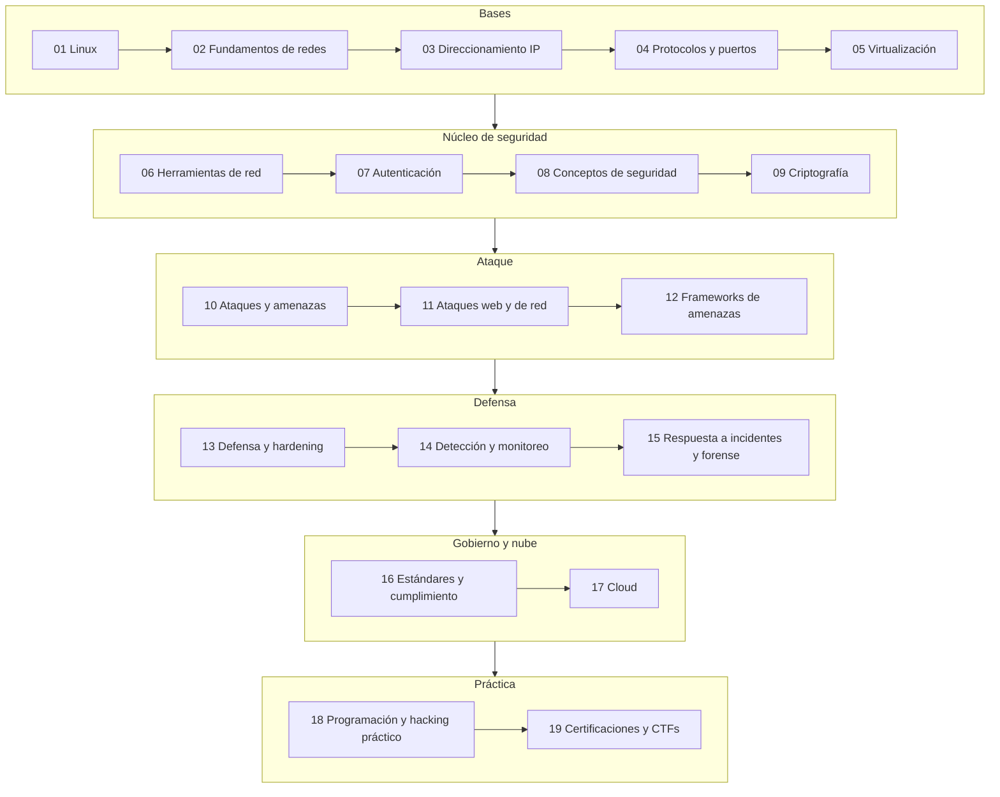

# Cyber Security

Guía de estudio del roadmap de Cyber Security de roadmap.sh, solo con los temas que no están marcados como skipped. El roadmap completo con los skipped marcados está en [`roadmap-cyber-security.pdf`](roadmap-cyber-security.pdf).

Cada tema tiene conceptos con analogías y ejemplos, una sección de recursos (videos, lectura y labs de práctica) y un cuadro resumen al final. Los ejercicios guiados de cada tema, paso a paso y con cada comando explicado, están en su `ejercicios.md`, enlazado desde la sección de práctica.

| # | Tema | Qué cubre |
|---|------|-----------|
| 01 | [Linux](01-linux/) | GUI y CLI, permisos, troubleshooting, comandos comunes |
| 02 | [Fundamentos de redes](02-fundamentos-de-redes/) | Modelo OSI, topologías, LAN/WAN/MAN/WLAN, NAS y SAN |
| 03 | [Direccionamiento IP](03-direccionamiento-ip/) | Subnetting, IP pública y privada, CIDR, gateway, VLAN, DMZ, ARP, NAT, DHCP, DNS, NTP, IPAM |
| 04 | [Protocolos y puertos](04-protocolos-y-puertos/) | Protocolos y puertos comunes, SSH, RDP, FTP, HTTP(S), TLS, handshakes |
| 05 | [Virtualización](05-virtualizacion/) | Hipervisores, host y guest, VMware, VirtualBox, ESXi, Proxmox, aislamiento |
| 06 | [Herramientas de red](06-herramientas-de-red/) | ping, dig, netstat, nmap, tcpdump, iptables, sniffers y analizadores |
| 07 | [Autenticación](07-autenticacion/) | AuthN vs AuthZ, MFA, Kerberos, RADIUS, LDAP, SSO, certificados |
| 08 | [Conceptos de seguridad](08-conceptos-de-seguridad/) | CIA, defensa en profundidad, Zero Trust, riesgo, backups, equipos, falsos positivos |
| 09 | [Criptografía](09-criptografia/) | Hashing, salting, intercambio de claves, PKI, protocolos seguros vs inseguros |
| 10 | [Ataques y amenazas](10-ataques-y-amenazas/) | Malware, ingeniería social, phishing y variantes, clasificación de amenazas |
| 11 | [Ataques web y de red](11-ataques-web-y-de-red/) | OWASP Top 10, SQLi, XSS, CSRF, MITM, DoS, ataques Wi-Fi, buffer overflow |
| 12 | [Frameworks de amenazas](12-frameworks-de-amenazas/) | Cyber Kill Chain, Diamond Model, MITRE ATT&CK, threat intel, OSINT, threat hunting |
| 13 | [Defensa y hardening](13-defensa-y-hardening/) | Hardening, NAC, firewalls, EDR, DLP, sandboxing, honeypots, seguridad Wi-Fi |
| 14 | [Detección y monitoreo](14-deteccion-y-monitoreo/) | IDS/IPS, SIEM, SOAR, logs, herramientas de análisis de amenazas |
| 15 | [Respuesta a incidentes y forense](15-respuesta-a-incidentes-y-forense/) | Proceso de IR, forense básico, herramientas de IR, comunicación |
| 16 | [Estándares y cumplimiento](16-estandares-y-cumplimiento/) | ISO 27001, NIST, RMF, CIS, CSF, auditoría, gestión de vulnerabilidades |
| 17 | [Cloud](17-cloud/) | Seguridad en la nube, IaC, serverless, modelos, AWS/GCP/Azure, S3 |
| 18 | [Programación y hacking práctico](18-programacion-y-hacking-practico/) | Lenguajes para seguridad, herramientas, exploit frameworks, GTFOBins, reversing, pentesting |
| 19 | [Certificaciones y CTFs](19-certificaciones-y-ctfs/) | TryHackMe, VulnHub, picoCTF, pwn.college, certificaciones de entrada y avanzadas, ruta sugerida |

Los temas están pensados para estudiarse en orden; cada bloque se apoya en el anterior:

